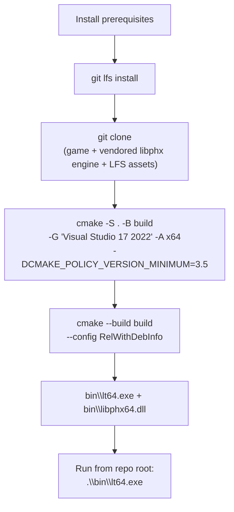

<!-- LimitTheory -->

# Building Limit Theory from a clean checkout

This repository: <https://github.com/DieSlower/LimitTheory> (a fork-style copy of the open-source [JoshParnell/ltheory](https://github.com/JoshParnell/ltheory) with the [libphx](https://github.com/JoshParnell/libphx) engine vendored in; both are public domain (Unlicense); the licences are kept in `LICENSE` and `libphx/LICENSE`).

Verified on Windows 11 with Visual Studio 2022 Community (MSVC 14.38), CMake 4.4.4, Git 2.45 and Git LFS 3.5, building from a clean `build/` and `bin/` with **no source patches**.



## 1. Prerequisites

| Tool | Version tested | Notes |
|---|---|---|
| Visual Studio 2022 (Community is fine) | 17.8, MSVC 14.38 | Workload **Desktop development with C++** (MSVC, Windows SDK) |
| CMake | 4.4.4 | Any CMake ≥ 3.21 can generate the VS 2022 solution; CMake 4.x needs the policy flag below |
| Git | 2.45 | |
| Git LFS | 3.5 | **Required**: ~130 asset files (~350 MB) are LFS objects |
| Python 3 | 3.14 (optional) | Only for the `configure.py` convenience wrapper |

The game links prebuilt Windows libraries that are committed in `libphx/ext` (SDL2, GLEW, FMOD, LZ4, LuaJIT, Bullet), so no package manager or extra installs are needed.

## 2. Get the sources

From a **Git Bash** or PowerShell prompt, in the folder where you want the project:

```bash
git lfs install                       # once per machine; skipping this breaks the assets
git clone https://github.com/DieSlower/LimitTheory.git LimitTheory
cd LimitTheory
```

The engine, `libphx`, is **vendored**: its source lives in `libphx/` as ordinary tracked files of this repository (no submodule, no second clone). The clone also downloads the LFS assets as part of the checkout.

### If the checkout is incomplete

| Symptom | Fix |
|---|---|
| Files in `res/` are a few lines of text (`version https://git-lfs…`) | `git lfs pull` |
| Checkout dies with `smudge filter lfs failed` / network error | Create the working tree without LFS, then pull: `GIT_LFS_SKIP_SMUDGE=1 git checkout -f master` followed by `git lfs pull` |
| `active post-checkout hook found during git clone` | `git-lfs` is not on `PATH`; install Git LFS or open a shell where `git lfs version` works |
| Existing non-empty folder | `git init`, `git remote add origin https://github.com/DieSlower/LimitTheory.git`, `git fetch origin`, `GIT_LFS_SKIP_SMUDGE=1 git checkout -f -B master origin/master`, `git lfs pull` — untracked files are left alone |

Sanity check:

```bash
git lfs ls-files | wc -l      # ~133
ls libphx                     # CMakeLists.txt ext include script src tool ...
```

## 3. Configure and build

From the repo root:

```powershell
cmake -S . -B build -G "Visual Studio 17 2022" -A x64 -DCMAKE_POLICY_VERSION_MINIMUM=3.5
cmake --build build --config RelWithDebInfo
```

- **`-DCMAKE_POLICY_VERSION_MINIMUM=3.5`** is needed with CMake 4.x only. The project declares `cmake_minimum_required(VERSION 3.0.2)`, which CMake 4 refuses. It is a command-line flag, not a source change.
- **`--config RelWithDebInfo`** matters. The Lua scripts load the engine library as `libphx64.dll`, and only the `RelWithDebInfo` configuration produces that name. A `Release` build yields `libphx64r.dll` and the game fails with `cannot load module 'libphx64'`.
- The Visual Studio generator is multi-config, so the `Release` default written in the project's `CMakeLists.txt` is harmless and **no patch to `CMakeLists.txt` or `libphx` is needed**.
- A full build takes a few minutes (the engine plus the game host).

Optional wrapper (equivalent, but uses whatever generator CMake picks by default, which may not be VS 2022): `python configure.py` then `python configure.py build`.

### Output

| Path | What |
|---|---|
| `bin\lt64.exe` | Game host executable |
| `bin\libphx64.dll`, `libphx64.pdb` | Engine library |
| `bin\SDL2.dll`, `glew32.dll`, `fmodL64.dll`, `fmodstudioL64.dll`, `liblz4.dll`, `lua51.dll` | Runtime dependencies copied by the build |
| `build\` | CMake / MSBuild intermediates and `LTheory.sln` (open this in Visual Studio to debug) |

## 4. Run

```powershell
.\bin\lt64.exe            # the game (LTheory)
.\bin\lt64.exe <AppName>  # any script from script\App\
```

Run from the repository root (`script\` and `res\` are found relative to the working directory). See [`RUNNING.md`](RUNNING.md) for the apps and config options and [`CONTROLS.md`](CONTROLS.md) for controls.

## 5. Clean / rebuild

| Goal | Command |
|---|---|
| Rebuild changed files only | re-run the `cmake --build` line |
| Full clean build | delete `build\` and `bin\`, then configure and build again (or `python configure.py clean`) |
| Update engine | Edit `libphx/` directly (it is part of this repo). To pull upstream engine changes, diff against [JoshParnell/libphx](https://github.com/JoshParnell/libphx) and merge by hand; the vendored snapshot is upstream commit `0f804f2` |

## 6. Troubleshooting

| Error | Cause / fix |
|---|---|
| `Compatibility with CMake < 3.5 has been removed` | Add `-DCMAKE_POLICY_VERSION_MINIMUM=3.5` |
| `Generator Visual Studio 17 2022 could not find any instance of Visual Studio` | Install the *Desktop development with C++* workload |
| `The CMAKE_CXX_COMPILER … cl is not a full path` | You used the default NMake generator outside a VS prompt; use `-G "Visual Studio 17 2022"` |
| `don't know how to make '..\bin\phx64.lib'` | Single-config generator with a hardcoded `Release` build type; use the VS generator, or build `RelWithDebInfo` |
| `cannot load module 'libphx64'` | You built `Release`; rebuild with `--config RelWithDebInfo`. Don't rename/copy the `…r.dll` (two engine copies get loaded and resource paths break) |
| `Resource_Resolve: Failed to find …` | Wrong working directory, or LFS assets not pulled |
| LFS network errors inside a sandboxed shell | Run `git lfs pull` from a normal terminal |

## 7. What is (and is not) committed

Everything produced by the steps above is ignored by `.gitignore`: `bin/`, `build/`, `obj/`, `log/`, `screenshot/`, IDE folders (`.idea/`, `.vs/`, `.vscode/`, `.claude/`), `graphify-out/`, and stray build artefacts (`*.pdb`, `*.ilk`, `*.exp`, CMake caches, `*.log`, `imgui.ini`).

Compared with the upstream game ([JoshParnell/ltheory](https://github.com/JoshParnell/ltheory) @ `21d4504`) this repository adds: `CLAUDE.md`, `Docs/`, `.gitignore` changes, and the engine ([JoshParnell/libphx](https://github.com/JoshParnell/libphx) @ `0f804f2`) copied into `libphx/` instead of referenced as a submodule. No engine or game source has been modified. The build needs no local patches.
