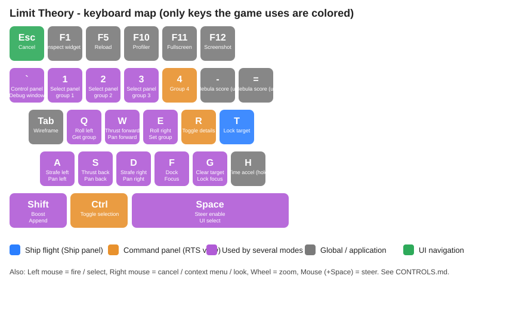
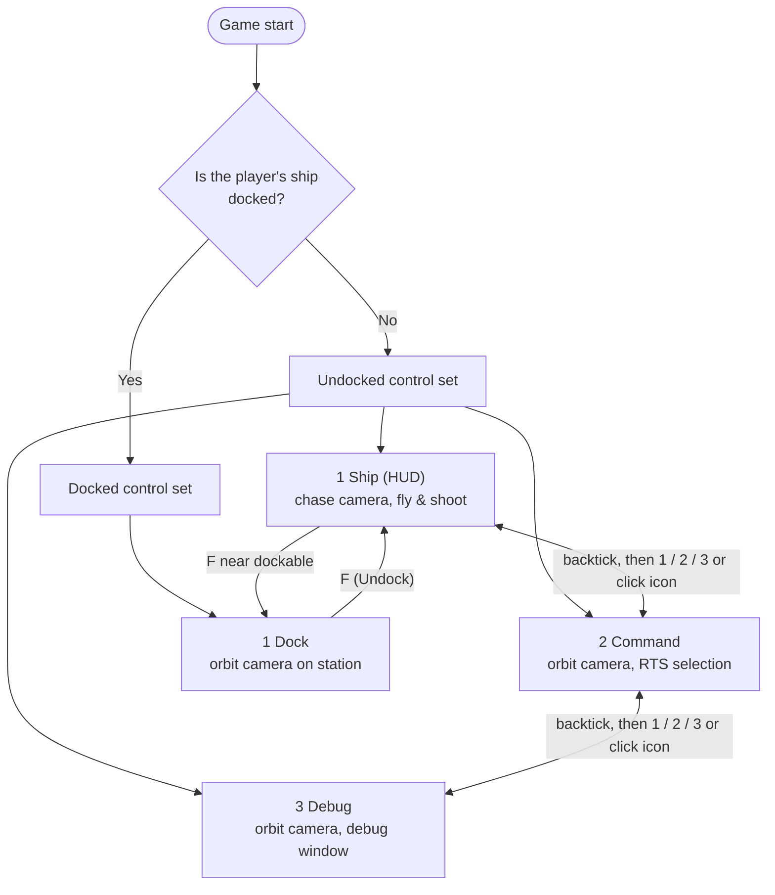
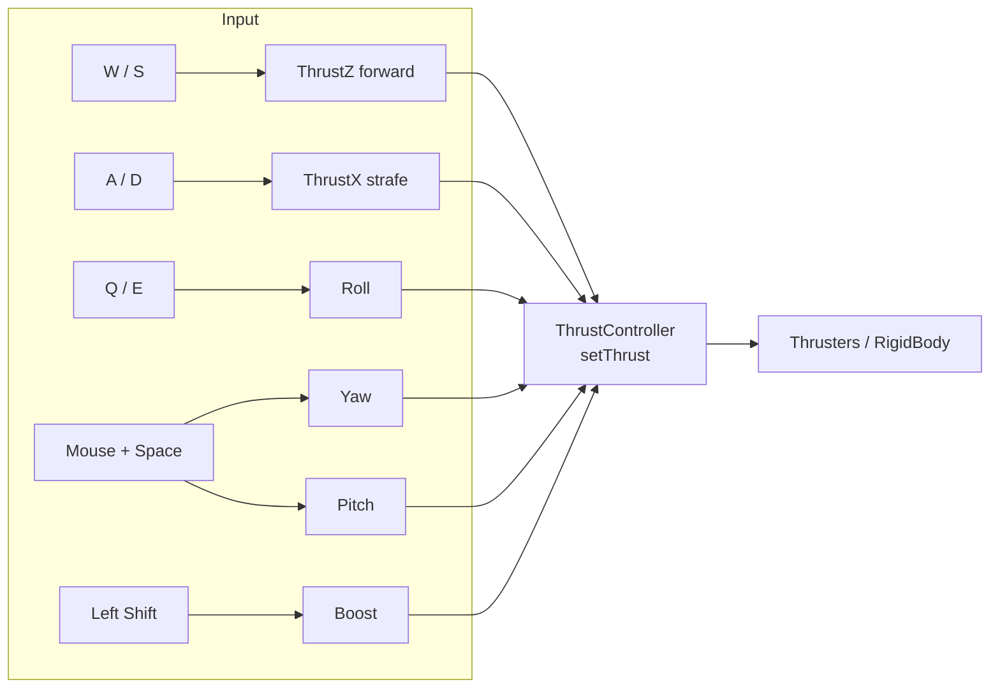
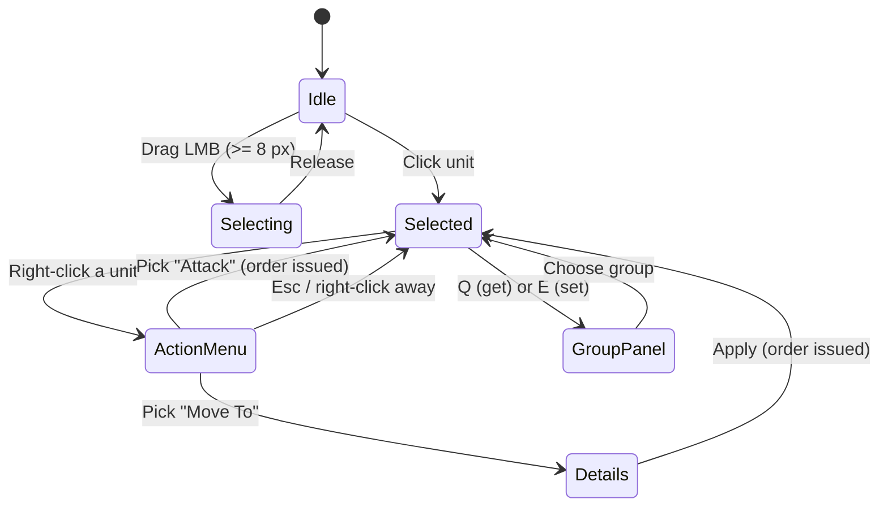
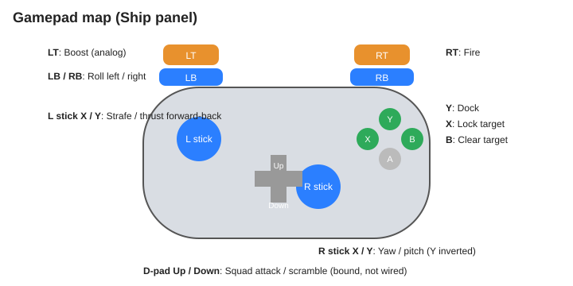

<!-- LimitTheory -->

# Limit Theory — Controls Reference

Everything the game (`ltheory`, default script `LTheory`) lets you press, click or drag, derived from the Lua sources:
`script/Game/Controls/*Bindings.lua`, `script/UI/Bindings.lua`, `script/phx/util/ApplicationBindings.lua` and the control panels that consume them.

> **Conventions.** `A / D` means "A for negative, D for positive" (a *Pair* axis). *Hold* = key stays down. *Tap* = fires on the press edge only.
> Where a physical key has several jobs, which one wins depends on the active **control panel** (see [§2](#2-control-panels)).

Contents: [1 Quick start](#1-quick-start) · [2 Control panels](#2-control-panels) · [3 Flying the ship](#3-flying-the-ship-ship-panel) · [4 Command view](#4-command-view-command-panel) · [5 Docked](#5-docked-dock-panel) · [6 Debug panel](#6-debug-panel) · [7 Menus & UI](#7-menus--widgets-ui-navigation) · [8 Global keys](#8-global--application-keys) · [9 Gamepad](#9-gamepad) · [10 Other apps](#10-other-apps--test-scripts) · [11 Quirks](#11-quirks-and-unfinished-bindings)

---

## 1. Quick start

Run from the repo root: `bin\lt64.exe` (default `LTheory`) — see `CLAUDE.md` for build steps and [`RUNNING.md`](RUNNING.md) for apps, config and mods.

| I want to… | Do this |
|---|---|
| Fly | Move with **W A S D**, hold **Space** and move the **mouse** to steer, **Left-click** to shoot |
| Go faster | Hold **Left Shift** (boost, costs energy) |
| Target something | **T** locks, **G** clears |
| Dock at a station | Get within 50 units of it, press **F** |
| Command my fleet | Press **`** (backtick) → pick the *Command* icon (or **2**) |
| Open debug tools | **`** → *Debug* icon (or **3**) |
| Quit | **Ctrl+W** (or close the window) |

You start with one player ship and 100 escort ships (each follows you), one station and an asteroid field.

---

## 2. Control panels

The game has several **control panels**. Only one is active at a time; each remaps the same keys to its own purpose. The top-centre **Control Selector** bar (toggled with **`**) lists the panels of the current *control set*.

| Panel | Camera | Purpose | Switch with |
|---|---|---|---|
| **Ship** (HUD) — default (`Config.ui.defaultControl`) | Chase camera behind the player's ship | Flying, shooting, targeting, docking | `` ` `` then **1**, or click its icon |
| **Command** | Free orbit camera around the world | Select your ships, give them orders | `` ` `` then **2**, or click its icon |
| **Debug** | Orbit camera | Debug window, UI widget inspector | `` ` `` then **3**, or click its icon |
| **Dock** | Orbit camera locked to the station | Shown while docked | automatic |

Panel switching rules:

1. **`` ` `` (Backtick)** shows/hides the Control Selector bar. When it is shown and focus is on it, **1 / 2 / 3** activate the 1st, 2nd and 3rd icon of the current set.
2. While the player's ship is playing an *action* (e.g. docking/undocking) the Dock set takes over; the undocked set returns when the action is over.
3. The Ship / Command / Debug panels are only selectable while undocked; the Dock set contains only the Dock panel.

---

## 3. Flying the ship (Ship panel)

### 3.1 Movement and steering

| Action | Keyboard / mouse | Gamepad | Notes |
|---|---|---|---|
| Thrust forward / back | **W** / **S** | Left stick Y | Forward = +Z axis of the ship |
| Strafe right / left | **D** / **A** | Left stick X | No vertical strafe is bound (the *up* thrust axis is always 0) |
| Roll right / left | **E** / **Q** | **RB** / **LB** | |
| Yaw | Hold **Space** + move **mouse X** | Right stick X | Mouse value is the cursor's offset from screen centre, not a delta |
| Pitch | Hold **Space** + move **mouse Y** | Right stick Y (inverted) | Set `Config.game.invertPitch = true` to flip |
| Boost | Hold **Left Shift** | Left trigger (analog) | Thrust ×(1 + 2·boost). Drains energy at `Config.game.boostCost` (10/s); no energy ⇒ no boost |
| Zoom camera | **Mouse wheel** | — | Scales chase-camera distance exponentially |

Steering detail: without **Space** held, the mouse does *not* steer — the cursor is then free to aim turrets (see below).

### 3.2 Weapons and targeting

| Action | Keyboard / mouse | Gamepad | Behaviour |
|---|---|---|---|
| Fire turrets | Hold **Left mouse button** | Right trigger | All turrets fire together |
| Aim turrets | Move the **mouse** | — | Each turret aims at the point on the cursor ray at the minimum socket range; with `Config.game.autoTarget = true` (default `false`) and a hostile target locked they aim at the target instead |
| Lock target | **T** (tap) | **X** | Locks the target the HUD currently highlights |
| Clear target | **G** (tap) | **B** | |
| Squad: attack target | — | D-pad Up | Bound but not wired to any action (see §11) |
| Squad: scramble | — | D-pad Down | Bound but not wired (see §11) |

Pulse weapon defaults (`Config.game`): damage 5, speed 600, range 1000, rate of fire 10/s.

### 3.3 Docking

| Action | Input | Gamepad |
|---|---|---|
| Dock with nearest station | **F** (tap) while within `Config.game.dockRange` (50) of a dockable | **Y** |

When a dockable is in range the HUD fades in a "Press ??? to Dock" prompt (the key name is still a placeholder in the source). Docking pushes a `DockAt` action onto the ship; once docked the control set switches to the Dock panel.

### 3.4 HUD

| Element | Meaning |
|---|---|
| Blue 3-tick ring in the centre | Reticle |
| Tracker brackets on objects | Targets (hidden when `Config.ui.showTrackers = false` — the shipped `Config.Local.lua` sets this to `false`) |
| Lock indicator | Currently locked target |
| Dock prompt (bottom centre) | Fades in near a dockable |
| Metrics bar (bottom) | `ms / fps / MB / K tris / draws / imms / swaps` (`Config.debug.metrics`) |

---

## 4. Command view (Command panel)

An RTS-style view over all units you own. Select ships, then right-click a unit for orders.

### 4.1 Camera

| Action | Input |
|---|---|
| Orbit (yaw/pitch) | Hold **Right mouse** and drag |
| Zoom | **Mouse wheel** (exponential) |
| Pan along ground plane | **W A S D** (speed scales with `log(zoom radius)`) |
| Focus on selection (or on your ship if nothing selected) | **F** (tap) |
| Focus and *lock* camera to selection | **G** (tap) — any pan key breaks the lock |
| Toggle Details window | **R** |

### 4.2 Selection

| Action | Input |
|---|---|
| Select one unit | **Left click** on it |
| Box select | **Left drag** (starts after 8 px; rect is padded 10 px so small units are easy to hit) |
| Add to selection | Hold **Shift** while selecting |
| Toggle units in selection | Hold **Ctrl** while selecting |
| Remove from selection | Hold **Ctrl + Shift** while selecting |

Unit marker colours come from the owner's *disposition* towards you (friendly / neutral / hostile). Off-screen units are drawn as dots at the screen edge.

### 4.3 Groups

| Action | Input |
|---|---|
| Open the Group panel to **store** the current selection | **E** (tap) |
| Open the Group panel to **recall** a group | **Q** (tap) |
| Pick entry | Click a button: *Friendlies* (all your living units) or *Group 1–3* |

The binding table also lists **1–4** as direct group-number keys (`CommandBindings.GroupNumber`), but nothing reads them yet; **1/2/3** are only used by the Control Selector.

### 4.4 Orders (right-click menu)

Right-click on a unit with a non-empty selection:

| Menu entry | Result |
|---|---|
| **Move To** | Opens a small window with a *Range* slider (0–1000, default 100) and **Apply**; each selected unit gets `Actions.MoveTo(target, range)` |
| **Attack** | Each selected unit gets `Actions.Attack(target)` immediately |

Close any popup with **Esc**, **right mouse** or **Left Shift** (the generic *Cancel* binding).

### 4.5 Details window (**R**)

Collapsible placeholders: *Formation* (Standard, Wedge) and *Stance* (Passive, Aggressive, Defensive). The buttons currently have no effect.

---

## 5. Docked (Dock panel)

| Action | Input |
|---|---|
| Undock | **F** (tap) / gamepad **Y** |

The camera orbits the station (radius 1000). The on-screen text still reads "Press ??? to Undock" (placeholder). There are no trading/shipyard menus in this build.

---

## 6. Debug panel

Activate with `` ` `` → **Debug** (or **3**). It uses the orbit camera and exposes:

| Action | Input |
|---|---|
| Show / hide the **Debug window** | **`` ` ``** (while the Debug panel is active; the window is visible at launch because `Config.debug.window = true`) |
| Open **widget inspector** for the focused UI widget | **F1** |
| *Regenerate system* | **R** — declared in `DebugBindings` but not hooked up |

**Debug window sections** (collapsible, expand by clicking the header):

| Section | Contents |
|---|---|
| Profiling | Frame time, EMA, FPS, Lua memory/alloc rate, GC passes/frequency, rigid-body count |
| Profiling Graphs | Live frame-time and Lua-memory graphs |
| Audio | Loaded / total / playing sounds |
| UI | Toggle grid layout, focus/active/scroll/nav/panel focus readouts, *Show Layout* and *Show Focus* checkboxes, mouse position, active input device type/ID |
| Auto-generated settings sections | One collapsible per registered engine setting group (e.g. render, post-fx: bloom, tonemap, aberration, radial blur, sharpen, supersample, wireframe…) with a **slider** for floats, a **checkbox** for bools and an **option slider** for enums |

The **widget inspector** is a window showing a widget's name, rect, origin, padding, sizes, alignment, with live sliders for align/stretch/max size and navigation buttons for its parent and children.

---

## 7. Menus & widgets (UI navigation)

All UI (Control Selector, popups, Debug window…) shares one input scheme (`script/UI/Bindings.lua`). It works with mouse or keyboard:

| Action | Mouse | Keyboard |
|---|---|---|
| Select / click / activate | Left click | **Space** |
| Cancel / close popup / go back | Right click | **Esc** or **Left Shift** |
| Move focus (within a nav group) | Hover | **W / A / S / D** |
| Previous / next group | — | **Q** / **E** |
| Scroll vertically / horizontally | Wheel (Y / X) | — |
| Drag windows | Left drag on title/panel | — |
| Operate sliders / checkboxes / collapsibles | Click / drag | focus + **Space** |

Windows may be **modal** (e.g. the Group panel and Action menu): clicks outside cancel them.

---

## 8. Global / application keys

Work in every app built on `Application` (`script/phx/util/ApplicationBindings.lua`):

| Key | Action |
|---|---|
| **Ctrl + W** | Quit |
| *Window close button* | Quit (`Button.System.Exit`) |
| **F5** | Hot reload: clears caches and re-sends `Engine.Reload`, re-runs preload |
| **Tab** | Toggle wireframe rendering |
| **H** (hold) | Time acceleration ×`Config.debug.timeAccelFactor` (10) |
| **F10** | Toggle profiler |
| **F11** | Toggle fullscreen |
| **F12** | Take a screenshot (supersampling temporarily raised to 2) |
| **-** / **=** | "Score nebula bad / good" — bound but no consumer in `LTheory` |

---

## 9. Gamepad

| Control | Ship panel action |
|---|---|
| Left stick X / Y | Strafe / thrust forward-back |
| Right stick X / Y | Yaw / pitch (Y inverted) |
| LB / RB | Roll left / right |
| Left trigger | Boost (analog) |
| Right trigger | Fire |
| X | Lock target |
| B | Clear target |
| Y | Dock / undock |
| D-pad Up / Down | Squad attack / scramble (declared, not wired) |

In the Command view the right stick orbits the camera (yaw/pitch ×3, squared response). A gamepad database (`gamecontrollerdb_205.txt`) is loaded at start-up so common pads are mapped automatically.

---

## 10. Other apps / test scripts

`bin\lt64.exe <Name>` runs `script/App/<Name>.lua`. The game proper is `LTheory`; the rest are developer test beds.

| Script | What it is | Notable controls |
|---|---|---|
| `LTheory` | The game | all of the above |
| `PhysicsTest` | Collision/trigger/bounding-box sandbox | **Ctrl+key** drives asteroid 1, **Shift+key** asteroid 2: **Return** attach/detach to ship, **-** / **=** scale, **I J K L U O** move, **T F G H R Y** rotate |
| `BSPTest` | BSP / mesh generation viewer | **1–6** test number, **F1–F4** alpha/cull/depth/view mode, **Left-drag** orbit, **wheel** zoom, **←/→** seed ±1, **↑** seed 0, **PgUp/PgDn** multiplier |
| `CoordTest` | Coordinate-system viewer | **Left-drag** orbit |
| `InputTest` | Prints raw pressed/released buttons | any key / button |
| `TestEcon`, `TestHmGui`, `TestImGui`, `TestIcon`, `TestStrMap`, `FMODTest`, `GenTex2D`, `Todo` | Economy simulation, immediate-mode GUI demos, icon, string map, audio, texture generation | mostly non-interactive |

---

## 11. Quirks and unfinished bindings

Collected from reading the code — useful when something "doesn't work":

1. **`` ` `` (Backtick) is double-booked**: it toggles the Control Selector (`MasterBindings.TogglePanel`) *and* the Debug window (`DebugBindings.ToggleDebugWindow`, only while the Debug panel is active).
2. **Left Shift is triple-booked**: ship Boost, the Command-view "append selection" modifier and the generic UI *Cancel*.
3. **Space** both enables mouse steering in the Ship panel and is the UI *Select* key.
4. **Same letters, different jobs per panel**: F = dock (Ship) / focus (Command) / undock (Dock); G = clear target (Ship) / lock focus (Command); Q/E = roll (Ship) / groups (Command) / UI prev-next group; W/A/S/D = fly (Ship) / pan (Command) / UI focus move.
5. **Unwired bindings**: `SquadAttackTarget` & `SquadScramble` (D-pad), `RegenerateSystem` (R in Debug), `ScoreNebulaBad/Good` (-, =), `CommandBindings.GroupNumber` (1–4).
6. **Placeholder prompts**: HUD dock prompt and Dock-panel undock prompt literally print `???` where the key name should be.
7. **Mouse steering is cursor-offset-based** and requires holding **Space**; there is no mouse-look without it.
8. **`Config.Local.lua` overrides** (shipped in the repo): tracker brackets off, vsync off, 1 asteroid field, 0 planets, 2 stations, instant jobs — change these if the HUD looks empty.
9. **Resolution**: default window 1600×900, resizable.

---

### Source map

| Topic | File |
|---|---|
| Ship bindings | `script/Game/Controls/ShipBindings.lua` |
| Camera bindings | `script/Game/Controls/CameraBindings.lua` |
| Command bindings | `script/Game/Controls/CommandBindings.lua` |
| Debug bindings | `script/Game/Controls/DebugBindings.lua` |
| Panel switching | `script/Game/Controls/MasterBindings.lua`, `MasterControl.lua` |
| HUD / flight logic | `script/Game/Controls/HUD.lua`, `script/Game/Components/ThrustController.lua` |
| Command logic | `script/Game/Controls/CommandControl.lua` |
| Dock logic | `script/Game/Controls/DockControl.lua` |
| UI navigation | `script/UI/Bindings.lua`, `script/UI/Canvas.lua` |
| Application keys | `script/phx/util/ApplicationBindings.lua`, `Application.lua` |
| Tunables | `script/Config.App.lua`, `script/Config.Local.lua` |
