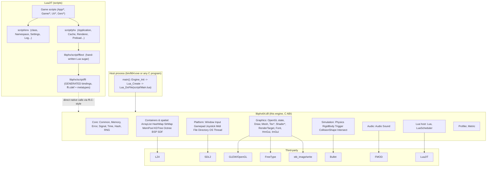
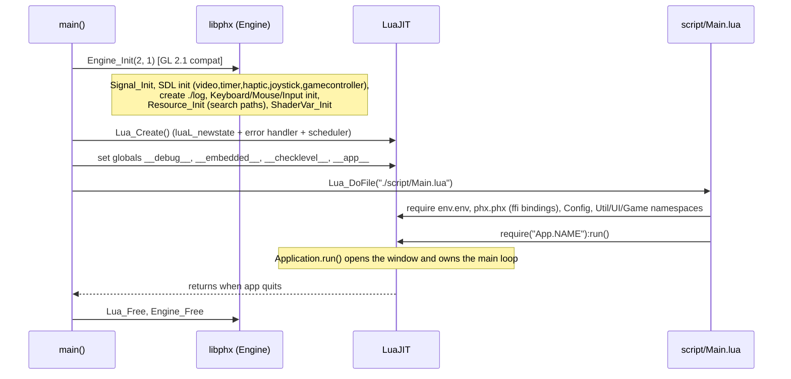
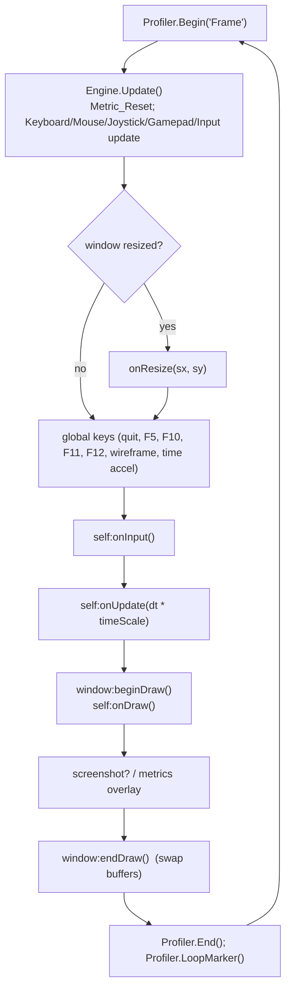
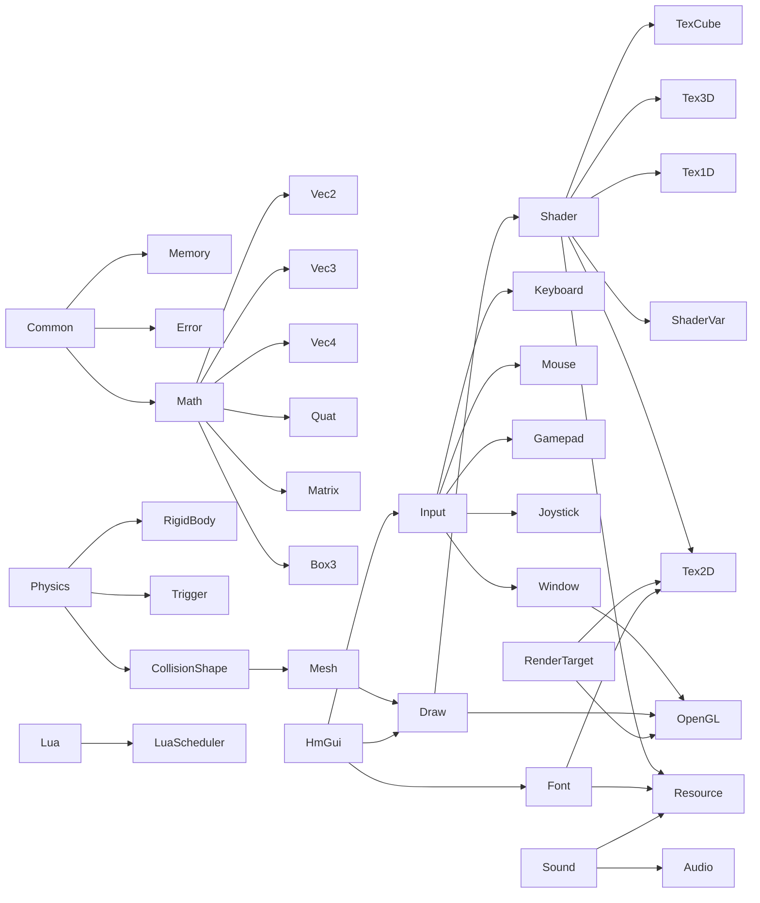

<!-- LimitTheory -->

# libphx architecture

How the engine is organized, how it starts, what happens each frame, and the conventions that hold it together.

## 1. Layered view

Key point: the **only** boundary between script and engine is the exported C ABI of `libphx64.dll`. The generated `ffi/*.lua` files are a mechanical mirror of that ABI.

## 2. Process start-up

For the game executable (`src/Main.cpp`) the sequence is:

Details worth knowing:

* `Engine_Init(major, minor)` fixes the **OpenGL context request** (compatibility profile, 24-bit depth, double buffered). The game passes `2, 1`.
* A mismatch between SDL's compiled and linked version is a hard error.
* `Engine_Init` creates a `log/` directory in the working directory.
* `Resource_Init` registers the **search path templates** (see §6).
* `Lua_Create` installs signal handlers so a crash prints a **Lua backtrace** (`Signal_AddHandlerAll` → `Lua_Backtrace`).

## 3. The frame loop (as driven by `Application`)

The engine has no internal loop. The Lua `Application:run()` template (`script/phx/util/Application.lua`) implements one:

* **Input** is polled once per `Engine_Update`; all `Input_*` queries then see a consistent snapshot for the frame.
* **dt** is wall-clock time between updates, scaled by the time-accel key.
* **Draw** is entirely immediate-mode GL driven from script; the engine does not queue render commands.

## 4. Memory and object lifetime

| Concern | Convention |
|---|---|
| Allocation | `MemAlloc`/`MemNew` (thin wrappers over `malloc`/`calloc`). Exported `Memory_*` variants let hosts use the engine's allocator. |
| Opaque handles | Created with `Type_Create…`/`Type_Load…`, destroyed with `Type_Free`. Always paired. |
| Reference counting | `RefCounted` macro (`_refCount`; `Type_Acquire` increments, `Type_Free` decrements and frees at zero). Used by `Mesh`, `Shader`, `Sound`, `Tex*`, … |
| Lua ownership | Generated metatypes expose `:managed()` which wraps the cdata in `ffi.gc(self, Type_Free)` so the Lua GC frees the C object. Without `:managed()` you must call `:free()` yourself. |
| Value types | `Vec2/3/4`, `Quat`, `Matrix`, `Box3`, … are plain structs, passed by pointer, returned via out-parameters (`Vec3f* out`). Lua `ffi.metatype`s add operators. |
| Strings | `cstr` = `char const*`. Returned strings are engine-owned (static or cached) — copy them if you keep them. |
| Errors | `Fatal(fmt, ...)` prints to stderr and (non-distributable builds, Windows) shows a *Break into debugger? / Cancel to continue* box. Most API misuse is `Fatal`, not an error code. |
| Assertions | `ASSERT` style macros in `Common.h`; `NYI` marks unimplemented paths. |

### Containers (internal)

`ArrayList(T, name)` (macro-generated dynamic array), `HashMap`, `StrMap`, `MemPool` (fixed-size cell allocator), `MemStack` (bump allocator), `LinkedList`, `List.h`, `Array.h` — header-only/macro style, used inside the engine and available to C hosts.

## 5. Subsystem dependency overview

## 6. Resource resolution

`Resource_Resolve(type, name)` walks an ordered list of `printf`-style templates per resource type, returning the first existing file; if none match it tries `name` as a literal path; otherwise `Fatal("Failed to find <Type> <name>")`.

| Type | Templates tried (in order; the `../shared/res/…` set only in non-distributable builds) |
|---|---|
| Font | `./res/font/%s.ttf`, `.otf`, then `%s.ttf`, `%s.otf` |
| Mesh | `./res/mesh/%s.bin`, `.obj`, `%s.bin`, `%s.obj` |
| Shader | `./res/shader/%s.glsl`, `%s.glsl` |
| Sound | `./res/sound/%s.mp3`, `.ogg`, `.ogx`, `.wav` |
| Tex1D / Tex3D | `./res/tex1d/%s.bin`, `./res/tex3d/%s.bin` |
| Tex2D | `./res/tex2d/%s.jpg`, `.png` |
| TexCube | `./res/texcube/%s` |
| Script / Other | `./res/script/%s.lua`, `./res/%s` |

All paths are **relative to the process working directory**, which is why the game must be launched from the repo root. `Resource_AddPath(type, "fmt/%s.ext")` appends custom templates.

## 7. Threading model

* The engine is **single-threaded by design**: the GL context, Lua state, input and physics are all driven from the main thread.
* `Thread` and `ThreadPool` (`ThreadPool_Create/Launch/Wait`) exist as utilities for hosts and for CPU-heavy native work, but nothing in the core engine uses them.
* FMOD runs its own mixing thread internally.
* `LuaScheduler` is a **time-sorted deferred-call queue**, not a thread: `Schedule(fn, arg, delay)` runs `fn(arg)` at a later `SchedulerUpdate`.

## 8. Build system

* `CMakeLists.txt` builds one target, `phx` (SHARED), output name `libphx<ARCH>[suffix]` where suffix is `d` (Debug), `r` (Release), none (RelWithDebInfo) or `rm` (MinSizeRel). The game's Lua loads `libphx64`, hence **RelWithDebInfo**.
* `script/build/Shared.cmake` defines platform/arch, output dir (`<top source dir>/bin`) and compile options. Windows flags: `/MP /MD /EHs-c- /fp:fast /GL /GS- /GR- /arch:SSE2` (no exceptions, no RTTI, fast-math, LTCG). Linux: `-Wall -fno-exceptions -ffast-math -fpic`.
* External DLLs (SDL2, GLEW, FMOD, LZ4, LuaJIT) are registered as imported targets and copied next to the executable after build.
* Bullet is linked from prebuilt static libs under `ext/lib/<platarch>`.

## 9. Design trade-offs (why it looks like this)

| Decision | Benefit | Cost |
|---|---|---|
| C ABI + LuaJIT FFI | Near-zero call overhead; binding code is generated; trivially embeddable | No C++ conveniences across the boundary; manual lifetime management; no type safety in scripts |
| Immediate-mode drawing from script | Very flexible; easy to experiment | CPU cost per draw call grows with scene complexity (Lua is the render loop) |
| No exceptions/RTTI, fast-math | Small, fast | Errors are fatal; numeric edge cases (NaN) are not trapped |
| Single-threaded | Simple and deterministic | Doesn't use multiple cores for AI/physics |
| Resources via search paths, no packaging | Simple dev loop, hot reload | Working-directory sensitivity; no archive format |
