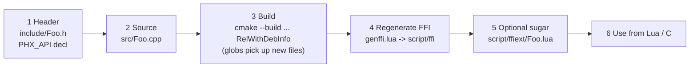

<!-- LimitTheory -->

# Extending libphx

Recipes for adding functionality to the engine: new C functions, new types, new shaders, bindings, platforms. Read [ARCHITECTURE.md](ARCHITECTURE.md) and [LUA_BINDINGS.md](LUA_BINDINGS.md) first.



## 1. Conventions to follow

### Naming

| Item | Rule | Example |
|---|---|---|
| Header / source | One module per file pair, named after the module | `include/Mesh.h`, `src/Mesh.cpp` |
| Header guard | `PHX_<Module>` | `#ifndef PHX_Mesh` |
| Exported function | `PHX_API ret Module_Verb(args);` | `Mesh_AddTri` |
| Constructor / destructor | `Module_Create…`, `Module_Free`; loaders `Module_Load`, `Module_FromX`; ref-counted types add `Module_Acquire` | `Shader_Load`, `Sound_Acquire` |
| Getters / setters | `Module_GetX`, `Module_SetX`; booleans `IsX`/`HasX` | `Window_SetVsync` |
| Methods | Put the object **first**: `Module_Verb(Module* self, …)` so the generator makes `obj:verb()` | `RigidBody_ApplyForce(RigidBody*, Vec3f*)` |
| Type markers | `OPAQUE_T Name;` for handles, `STRUCT_T Name;` + `struct Name {…};` for transparent structs, `ENUM_T typedef uint32 Name;` for enums | `OPAQUE_T Mesh;` |
| Internal-only API | Not `PHX_API`; mark `PRIVATE` and keep under a `/* --- Private API --- */` banner | `LuaScheduler_Init` |
| Excluded header | `#define __FFI_IGNORE__` near the top | `Lua.h`, `ArrayList.h` |

### Style (from the existing sources)

* C++ used as "C with namespaces-by-prefix": no classes in the public API, no templates, **no exceptions, no RTTI** (the compiler flags forbid them), minimal STL (none in headers).
* Two-space indent, `Type* Name_Verb (args)` with a space before `(`, braces on the same line, `/* */` banner comments with a one-line description per function.
* Prefer value out-params (`Vec3f* out`) over returning structs across the ABI; scalars may be returned directly.
* Allocate with `MemNew/MemNewZero/MemAlloc`; never mix with `new`/`delete`.
* Use `Fatal(...)` for unrecoverable misuse; it is the standard error path.
* Profile hot functions with `FRAME_BEGIN`/`FRAME_END` or `Profiler_Begin/End`.
* GL state changes use the push/pop stacks (`RenderState`, `BlendMode`, …) — never leave state modified on return.

## 2. Adding a C function to an existing module

1. **Declare** it in the module header, inside the existing `PHX_API` block, with a comment if behaviour is non-obvious:
   ```c
   // include/Mesh.h
   PHX_API float Mesh_GetSurfaceArea (Mesh*);
   ```
2. **Implement** it in `src/Mesh.cpp`:
   ```cpp
   float Mesh_GetSurfaceArea (Mesh* self) {
     float area = 0;
     for (int i = 0; i + 2 < ArrayList_GetSize(self->index); i += 3) {
       /* ... accumulate triangle areas ... */
     }
     return area;
   }
   ```
3. **Build** (see [GETTING_STARTED.md](GETTING_STARTED.md)). `CMakeLists.txt` uses `file(GLOB …)`, so **re-run CMake configure** when you add or remove files; editing existing files only needs a build.
4. **Regenerate bindings** (§5). `mesh:getSurfaceArea()` and `Mesh.GetSurfaceArea(mesh)` now exist.
5. **Test** from Lua or a C host; add a demo to `script/App/` if useful.

## 3. Adding a new module (type)

Checklist for a new opaque type `Widget`:

1. `include/Widget.h`:
   ```c
   #ifndef PHX_Widget
   #define PHX_Widget

   #include "Common.h"

   /* --- Widget -----------------------------------------------------------
    *   One-line description. Ownership/threading notes here.
    * ------------------------------------------------------------------- */

   PHX_API Widget* Widget_Create (int size);
   PHX_API void    Widget_Free   (Widget*);
   PHX_API int     Widget_GetSize(Widget*);

   #endif
   ```
2. Forward-declare the type where the other opaque types are declared. Look at how `Mesh` is declared (`OPAQUE_T Mesh;` in `Common.h`); add `OPAQUE_T Widget;` the same way so both C and the generator see it.
3. `src/Widget.cpp` — define the struct and functions. Use `RefCounted` (`RefCounted_Init/Acquire/Free` from `RefCounted.h`) if the object is shared.
4. Re-run CMake configure (new file) and build.
5. Regenerate `script/ffi` — a new `Widget.lua` appears and `libphx.lua` gains the `ffi.cdef` for the type.
6. Optionally add `script/ffiext/Widget.lua` with `onDef_Widget` / `onDef_Widget_t` hooks.
7. If the module should be listed in the API reference categories, edit `CATS` in `Docs/Engine/gen_api_reference.py`.

### Adding a transparent struct

```c
STRUCT_T Particle;
struct Particle { float x, y, z; float life; };
```

The generator flattens nested structs and emits a `Particle(x, y, z, life)` constructor plus `:clone()`. Beware its documented limitation about struct/array alignment; keep fields uniformly typed.

### Adding an enum / flag set

Enum types are plain integer typedefs declared once in `include/Common.h` (look for `ENUM_T typedef uint32 WindowMode;`), and each value is an exported `const` defined in the module's source:

```c
// include/Common.h  (with the other enum typedefs)
ENUM_T typedef uint32 FooMode;
```
```c
// include/FooMode.h
#include "Common.h"
PHX_API const FooMode FooMode_A;
PHX_API const FooMode FooMode_B;
```
```cpp
// src/FooMode.cpp
#include "FooMode.h"
const FooMode FooMode_A = 0x1;
const FooMode FooMode_B = 0x2;
```

Lua sees `FooMode.A`, `FooMode.B`. Flag enums are combined with `Bit.Or32`.

## 4. Adding shaders

No C++ changes are needed.

1. Create `res/shader/fragment/<group>/<name>.glsl` (and, if needed, `res/shader/vertex/<name>.glsl`). Write plain GLSL 1.30.
2. Pull in shared code with `#include name` (files in `res/shader/include/`), and declare auto-bound uniforms with `#autovar mat4 mView`.
3. Load with `Shader.Load('vertex/wvp', 'fragment/<group>/<name>')` or through `Cache.Shader('wvp', '<group>/<name>')` (which prefixes `vertex/` and `fragment/`).
4. Set per-draw values with `Shader.SetFloat/…` after `shader:start()`; share scene-wide values via `ShaderVar.Push*`/`Pop`.
5. Press **F5** in the running game to reload without restarting (`Cache.Clear()` re-reads shader sources).

Debug tips: compile errors are printed with the offending source (check the console and `log/`); `RenderState.PushWireframe(true)` and the Tab key help diagnose geometry.

## 5. Regenerating the Lua FFI bindings

```powershell
cd D:\Development\LimitTheory\libphx
$env:PATH = "D:\Development\LimitTheory\bin;$env:PATH"        # lua51.dll for the bundled luajit
.\ext\bin\win64\luajit.exe tool\genffi.lua include libphx script\ffi 1
```

* Commit the changed `script/ffi/*.lua`; they are generated source, not build output.
* Review the diff: a new function should appear in the module's `ffi.cdef`, symbol table and (if its first arg is the module type) the metatype.
* If a function is not picked up, check it is a single `PHX_API …;` statement, not behind `#if`, and not in a header containing `__FFI_IGNORE__`.
* The Lua file is only needed by script users; a C host can call the function right after the build.

## 6. Regenerating this reference

`Docs/Engine/API_REFERENCE.md` is generated from the headers:

```powershell
cd D:\Development\LimitTheory\Docs\Engine
python gen_api_reference.py
```

## 7. Extending from Lua only

Often you do not need to touch C at all:

| Need | Where |
|---|---|
| Operators/helpers on vectors, quaternions, matrices | `libphx/script/ffiext/Vec3.lua`, `Quat.lua`, … (`onDef_Vec3_t`) |
| Convenience wrappers around raw out-parameters | `ffiext/<Module>.lua` |
| New render pipeline stage / post effect | `script/phx/util/Renderer.lua` + a fragment shader under `res/shader/fragment/filter` |
| New cached asset type | `script/phx/util/Cache.lua` |
| New window/loop behaviour | subclass or replace `script/phx/util/Application.lua` |
| New setting visible in the debug window | `Settings.addBool/addFloat/addEnum(...)` |

## 8. Platform and toolchain notes

| Topic | Guidance |
|---|---|
| Linux | `Shared.cmake` has a Linux branch (flags) and `ext/lib/linux64` holds libs, but `CMakeLists.txt` has `elseif (LINUX) # TODO` for external-lib wiring. Expect to finish that block: register SDL2/GLEW/FMOD/LZ4/LuaJIT via `find_library` or the shipped `.so` files. |
| 32-bit | Libraries for `win32` are shipped; set `ARCH` via a 32-bit generator (`-A Win32`); FMOD names switch to `fmodL.dll`. Untested here. |
| macOS | `Common.h` recognises `__APPLE__`; no libs or build branch exist. |
| New third-party lib | Put headers in `ext/include/<lib>/`, binaries in `ext/lib/<platarch>/`, and register with `add_extlib`/`target_link_extlib` in `CMakeLists.txt`. |
| Debug builds | `-DCMAKE_BUILD_TYPE=Debug` (single-config) or `--config Debug` produces `libphx64d.dll`; Lua loads the `d` variant when `__debug__` is true (`Main.cpp` sets it from `DEBUG`). |
| Compiler flags | `/fp:fast`, no exceptions, no RTTI, LTCG. Code that relies on IEEE edge cases (NaN comparisons) must be reviewed. |

## 9. Contribution checklist

- [ ] Header comment explains ownership, threading and error behaviour
- [ ] Every allocation has a matching free; `Type_Free` handles NULL
- [ ] No GL state left changed; push/pop balanced
- [ ] `Fatal` only for programmer error; recoverable errors return a value
- [ ] FFI bindings regenerated and committed; Lua sugar added if the raw API is awkward
- [ ] `API_REFERENCE.md` regenerated
- [ ] Exercised from a test app in `script/App/` (the repo has no automated test suite)
- [ ] Builds in `RelWithDebInfo` with no new warnings
