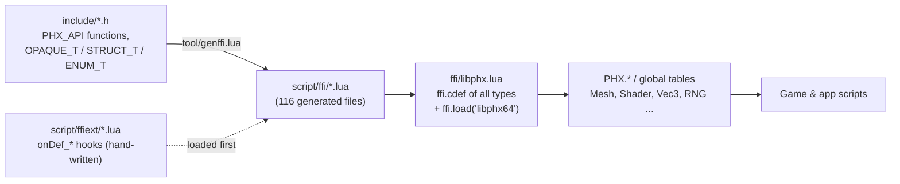
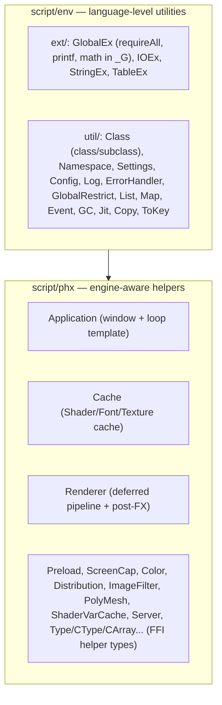

<!-- LimitTheory -->

# Lua bindings: how the C API reaches scripts

libphx has **no hand-written binding code**. A generator reads the public headers and emits Lua files that declare the C ABI to LuaJIT's FFI and wrap every opaque type and struct in an idiomatic Lua table + metatable. This document explains that pipeline, the conventions that make it work, and the Lua layers built on top.



## 1. The generator (`tool/genffi.lua`)

### Running it

```powershell
# from D:\Development\LimitTheory\libphx   (lua51.dll must be findable: add ..\bin to PATH)
$env:PATH = "D:\Development\LimitTheory\bin;$env:PATH"
.\ext\bin\win64\luajit.exe tool\genffi.lua include libphx script\ffi        # add a 4th arg (1) for verbose output
```

| Argument | Meaning |
|---|---|
| `arg[1]` | Directory of headers to parse (`include`) |
| `arg[2]` | Library name; becomes the `ffi.load` name base and the `libphx` Lua variable (`libphx`) |
| `arg[3]` | Output directory for the generated `*.lua` files |
| `arg[4]` | Optional verbose flag |

Verified: regenerating from the current headers reproduces the committed `script/ffi/` byte-for-byte (apart from line endings). The generator is a pure-Lua script; it needs the bundled LuaJIT (`ext/bin/<plat>/luajit`) and the `lfs` module that LuaJIT build includes. Failures are mostly *silent* (see TODO list at the bottom of the script).

### What it parses

| Pattern in a header | Result |
|---|---|
| `PHX_API <ret> <Name_Func>(args);` | A function declaration in `ffi.cdef`; entry in the module table |
| `PHX_API const <Enum> <Enum_Value>;` / `const <Enum> <Enum_Value> = N;` | An enum constant (exposed as `Enum.Value`) |
| `ENUM_T typedef uint32 TypeName;` / `typedef … TypeName;` | An enum or scalar typedef |
| `OPAQUE_T TypeName;` | An opaque handle type (`struct TypeName`), gets a class metatype |
| `STRUCT_T TypeName;` + `struct TypeName { … };` | A transparent struct (fields visible to Lua), gets a metatype with `__call` constructor |
| `typedef R (*Name)(args);` | Function-pointer type |
| File contains `__FFI_IGNORE__` | The whole header is skipped (internal headers such as `ArrayList.h`, `Lua.h`, `PhxSignal.h`) |

Comments are stripped first. Anything declared `PRIVATE` (hidden visibility) is not matched because it lacks `PHX_API`.

### Naming and method derivation

* **Module name** = text before the first `_` in the function name (`Mesh_AddTri` → module `Mesh`).
* **Static/free function** → `Mesh.AddTri(mesh, …)` (the function name minus module, kept as written).
* **Method** → any function whose *first parameter type* starts with the module name becomes an instance method with lower-camel-case name: `Mesh_AddTri(Mesh*, …)` ⇒ `mesh:addTri(…)`.
* `Type_Free` additionally yields `:managed()` = `ffi.gc(self, Type_Free)`.
* A function named `ToString` becomes `__tostring`.
* Structs also get `:clone()`.
* Out-parameters (`Vec3f* out`) stay explicit in the raw API; hand-written `ffiext` code wraps the common ones to return values.

### Example: what one header becomes

```c
// include/RNG.h
PHX_API RNG*    RNG_Create      (uint64 seed);
PHX_API void    RNG_Free        (RNG*);
PHX_API double  RNG_GetUniform  (RNG*);
```

```lua
-- script/ffi/RNG.lua  (generated)
ffi.cdef [[
  RNG*   RNG_Create     (uint64 seed);
  void   RNG_Free       (RNG*);
  double RNG_GetUniform (RNG*);
]]
RNG = { Create = libphx.RNG_Create, Free = libphx.RNG_Free, GetUniform = libphx.RNG_GetUniform }
-- ... plus a class metatype:
mt = { __index = {
  managed    = function (self) return ffi.gc(self, libphx.RNG_Free) end,
  free       = libphx.RNG_Free,
  getUniform = libphx.RNG_GetUniform,
} }
```

In Lua:

```lua
local rng = RNG.Create(42):managed()   -- freed automatically by the GC
local x   = rng:getUniform()           -- same as RNG.GetUniform(rng)
```

## 2. The generated files

* **`script/ffi/libphx.lua`** — one big `ffi.cdef` with all typedefs, enums and transparent structs (`Vec2f/3f/4f/…`, `Box3f`, `Quat`, `Matrix`, `Collision`, …), forward declarations for every opaque type, then:
  ```lua
  local debug = __debug__ and 'd' or ''
  local arch  = jit.arch == 'x86' and '32' or '64'
  libphx.lib  = ffi.load(string.format('libphx%s%s', arch, debug), false)
  ```
  `ffi.load` resolves `libphx64.dll` through the normal DLL search path (the exe directory first). This is why the DLL name must match the build configuration.
* **`script/ffi/<Module>.lua`** — one per module: `ffi.cdef` for its functions, a *global symbol table*, and a *metatype for class instances*; ends with `return <Module>`.

## 3. Extension hooks (`script/ffiext`)

Because FFI metatables are immutable once created, the generator calls optional global hooks **while building** each table. Hand-written files in `script/ffiext/` define them; they must be loaded **before** `ffi/*` (see `script/phx/phx.lua`: `PHX.Ext = requireAll('ffiext')` runs first).

| Hook | Signature | Called when | Typical use |
|---|---|---|---|
| `onDef_<Module>(t, mt)` | `t` = the module table, `mt` = its metatable | building the global symbol table | add Lua-only module functions (`Vec3.Identity`), wrap constructors |
| `onDef_<Module>_t(t, mt)` | `t` = ctype, `mt` = instance metatable | before `ffi.metatype` | add operators (`__add`, `__mul`, `__eq`), extra methods, `__index` entries |

Examples that ship with the engine:

```lua
-- ffiext/BSP.lua : validate the mesh and print engine errors before building
function onDef_BSP (t, mt)
  t.Create = function (...)
    local e = libphx.Mesh_Validate(...)
    if e ~= 0 then print('BSP Incoming Mesh Error:'); libphx.Error_Print(e) end
    return libphx.BSP_Create(...)
  end
end

-- ffiext/Vec3.lua : arithmetic on the transparent struct
local function defineVec3_t (t, mt)
  local Vec3 = t
  function mt.__add (a, b) return Vec3(a.x + b.x, a.y + b.y, a.z + b.z) end
  function mt.__index.iadd (a, b) a.x = a.x + b.x; a.y = a.y + b.y; a.z = a.z + b.z end
  -- ... length, normalize, cross, dot, lerp ...
end
```

Existing extension modules: `BSP, Box3, Directory, File, Font, Input, Math, Matrix, Mesh, Physics, Profiler, Quat, RNG, Ray, Tex2D, Tex3D, Vec2, Vec3, Vec4, Viewport, Window`.

## 4. Value types and calling conventions

| Rule | Detail |
|---|---|
| Vectors are structs | `Vec3f {x,y,z}` (float), `Vec3d`, `Vec3i`, … Created with `Vec3f(x, y, z)` (the `__call` constructor). Passed by pointer to C, so Lua reuses the same cdata cheaply. |
| Out-parameters | Raw API: `RNG_GetSphere(RNG*, Vec3f* out)`. `ffiext` often wraps these so `rng:getSphere()` returns a vector. |
| Strings | `cstr` is `const char*`; LuaJIT converts Lua strings automatically; use `ffi.string(p)` to copy a returned `cstr`. The patched global `tostring` does this for you. |
| Booleans/numbers | `bool` ↔ Lua boolean; all numeric types ↔ Lua number (64-bit ints are cdata and need `ULL`/`LL` literals). |
| Null | `nil` ↔ `NULL` pointer for pointer parameters. |
| Enums | Exposed as numeric tables: `Button.Keyboard.Escape`, `BlendMode.Alpha`, `TexFormat.RGBA16F`. Bit-flag enums combine with `Bit.Or32` (e.g. window modes). |
| Lifetime | Opaque objects: `:managed()` for GC-owned, else explicit `:free()`. Ref-counted types also have `:acquire()`. |

## 5. The Lua environment on top (`script/env`, `script/phx`)

These layers live in the **game repository's** `script/` directory but are effectively the engine's standard library.



Highlights:

| Piece | What it gives you |
|---|---|
| `requireAll('dir.path')` | `require` every `*.lua` in a package directory and return a table (used to load whole namespaces) |
| `Namespace.Load/LoadInline/Inline/Inject` | Put a module table into `_G`, optionally *injecting* its members as globals with a warning on shadowing (you will see `Game.SocketType is shadowing PHX.FFI.SocketType` at start-up) |
| `class(ctor)` / `subclass(base, ctor)` | Tiny OOP with chained constructors and virtual dispatch via metatables |
| `Settings.addBool/addFloat/addEnum`, `Settings.get/set` | Typed, named engine/game settings; the debug window builds sliders/checkboxes from them automatically |
| `GlobalRestrict.On()` | Makes access to undefined globals an error (you will see `Attempt to access undefined global variable 'X'`) |
| `Cache.Shader(vs, fs)`, `Cache.Font(name, size)`, `Cache.Texture(name)` | Memoised loaders (`Shader.Load('vertex/'..vs, 'fragment/'..fs)`); `Cache.Clear()` on reload |
| `Preload.Add(fn)` | Register asset-loading functions that run once a GL context exists |
| `Application` | Window/loop template (see [GETTING_STARTED.md](GETTING_STARTED.md)) |
| `Renderer` | Multi-buffer deferred renderer + bloom/tonemap/sharpen/aberration/vignette (see [SUBSYSTEMS.md](SUBSYSTEMS.md)) |
| `ErrorHandler` | Pretty-prints Lua errors with source excerpts, used by `Env.Call` and the scheduler |

### Global symbols available to every script

After `phx.phx` runs, the following are global: every engine module table (`Draw`, `Mesh`, `Shader`, `Input`, `Button`, `Window`, `RNG`, `Physics`, `Vec3f`, …), the PHX utilities (`Application`, `Cache`, `Preload`, `Renderer`, `Color`, `Distribution`), `PHX` (all namespaces) and the Lua helpers (`insert`, `remove`, `format`, `printf`, `join`, `class`, `subclass`, `Log`, `Settings`, `Config`).

## 6. Calling the engine from C++ hosts

C/C++ hosts do not need any of the above; they include the same headers and link `phx64.lib`. The generated Lua is purely a convenience for script users. If you add a function to the C API, hosts can use it immediately; script users get it after re-running the generator (see [EXTENDING.md](EXTENDING.md)).

## 7. Limits to keep in mind

* The generator uses regular expressions, not a C parser. Keep declarations on the supported single-statement form; avoid macros and unusual formatting in `PHX_API` lines.
* Methods are detected by *prefix match* on the first parameter type: a function taking `Mesh*` first becomes `mesh:fn()` even if that is not what you want. `Quat_Identity`-style single-out-parameter functions get odd method bindings (acknowledged in the generator's TODOs).
* Metatables are fixed after creation; hook functions are the only extension point.
* Arrays of structs and `const*` fields have incomplete handling (generator TODOs).
