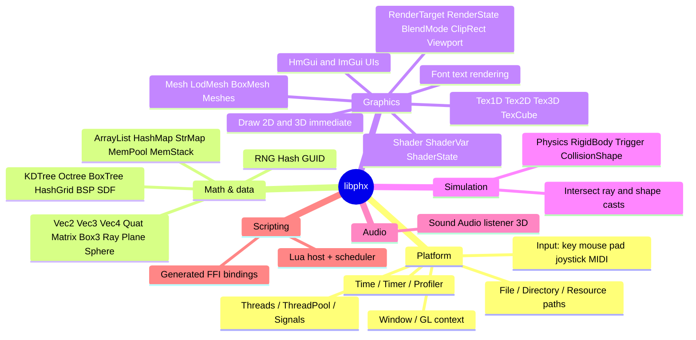

<!-- LimitTheory -->

# libphx — the Phoenix engine

> **libphx** ("LibPHX", "Phoenix Engine") is a lightweight, mostly-C game engine written for *Limit Theory*, packaged as a **shared library** with a flat C API and designed to be driven from **LuaJIT** through its FFI.

This is the entry point for the engine documentation. The source lives in [`libphx/`](../../libphx/) (vendored from [JoshParnell/libphx](https://github.com/JoshParnell/libphx) @ `0f804f2`; public domain / Unlicense). The upstream README itself says the engine is *"abandoned and mostly undocumented"* — these documents were written by reading the code, so they describe what the code does, and flag TODOs and rough edges honestly.

## Documents

| Document | Read it to learn |
|---|---|
| **README.md** (this file) | What libphx is, philosophy, feature list, repository layout, status |
| [GETTING_STARTED.md](GETTING_STARTED.md) | Build it, open a window, draw, load assets, minimal Lua and C hosts |
| [ARCHITECTURE.md](ARCHITECTURE.md) | Layers, process start-up, the frame loop, memory/ownership, threading, build system |
| [LUA_BINDINGS.md](LUA_BINDINGS.md) | How the C API reaches Lua: the FFI generator, metatypes, `onDef_*` hooks, the `ffiext` layer, the Lua environment on top |
| [SUBSYSTEMS.md](SUBSYSTEMS.md) | Per-subsystem guides: windowing, input, rendering, shaders, meshes/textures, physics, audio, UI (HmGui), resources, profiling, scheduler |
| [API_REFERENCE.md](API_REFERENCE.md) | Catalog of every public module/header with its functions, grouped by category |
| [EXTENDING.md](EXTENDING.md) | How to add C functions, types, shaders, bindings, platforms; coding conventions; checklist |
| [FAQ_LIMITATIONS.md](FAQ_LIMITATIONS.md) | Known limitations, platform support, gotchas, troubleshooting, glossary |

Related game-side documents: [`../Game/`](../Game/README.md).

## 1. What is libphx?

| | |
|---|---|
| **Kind** | Game engine *as a library* (not a framework): your code owns `main` and the loop; the engine never calls you back |
| **Language** | C-style C++ (no exceptions, no RTTI, no STL in the public API); ~18,500 lines in 113 `.cpp` files, 129 public headers |
| **Public API** | ≈1,150 exported `PHX_API` functions (flat `extern "C"`, `Module_Verb` naming) |
| **Scripting** | LuaJIT 2.x via FFI — calls into the engine are compiled to direct native calls |
| **Graphics** | OpenGL (compatibility profile; default context 2.1, GLSL `#version 130`) through SDL2 + GLEW |
| **Physics** | Bullet 2.87 behind a small `Physics`/`RigidBody`/`Trigger` API |
| **Audio** | FMOD (core API) with 3D positional sound |
| **Windowing / input** | SDL2: keyboard, mouse, gamepad, joystick, MIDI, optional VR hooks |
| **Platforms** | Windows x64 (primary, verified), Windows x86 (libs present), Linux x64 (libs present, CMake branch is a TODO) |
| **License** | Public domain (The Unlicense) |
| **Status** | Abandoned by its author; stable but frozen |

### Philosophy

1. **Library, not framework.** Control flow stays in your hands. You call `Engine_Update()`, you decide when to draw, when to swap.
2. **Script drives, engine computes.** Gameplay, UI composition and content logic live in Lua; heavy kernels (meshing, BSP, physics, noise, culling, text, GUI layout) live in C. LuaJIT FFI makes the boundary nearly free.
3. **Flat C ABI.** One function per verb (`Mesh_AddTri`, `Shader_SetFloat3`). That makes bindings mechanical (the Lua FFI files are *generated* from the headers).
4. **Data in, data out.** Small value types (`Vec3f`, `Quat`, `Matrix`) are plain structs passed by pointer; opaque handles for everything stateful.
5. **No kitchen sink.** No scene graph, no ECS, no editor, no asset pipeline. Those belong to the game (see the game docs for the entity/component system built in Lua).

### Feature map



## 2. Repository layout

```text
libphx/
├── CMakeLists.txt          # builds the `phx` shared library (+ links ext libs)
├── include/                # 129 public headers (the API)  -> *.h
├── src/                    # 113 implementation files      -> *.cpp (+ 2 private headers)
├── script/
│   ├── build/Shared.cmake  # platform / arch / compiler flags shared with the game
│   ├── ffi/                # GENERATED Lua FFI bindings, one file per header + libphx.lua
│   └── ffiext/             # hand-written Lua extensions layered on the generated bindings
├── tool/genffi.lua         # the generator that produces script/ffi from include/*.h
└── ext/                    # third-party: headers (include/) and prebuilt libs (lib/win32|win64|linux64, bin/)
    └── include/{GL,bullet,fmod,freetype,luajit,lz4,sdl,stb}
```

Outside `libphx/` the engine relies on the **game repository** for:

* `res/shader/…` — the GLSL library (vertex, fragment, includes) the engine loads by name;
* `res/font`, `res/mesh`, `res/tex*`, `res/sound` — assets resolved by `Resource`;
* `script/env`, `script/phx` — the Lua runtime environment (class system, namespaces, `Application` template, caches).

## 3. A 30-second taste

```lua
-- script/App/Hello.lua  — run with: bin\lt64.exe Hello
local Hello = Application()

function Hello:onInit ()
  self.font = Font.Load('NovaMono', 16)
  self.rng  = RNG.FromTime()
end

function Hello:onDraw ()
  Draw.Clear(0.08, 0.08, 0.12, 1)
  Draw.Color(1, 0.6, 0.1, 1)
  Draw.Rect(100, 100, 200, 120)
  self.font:draw('Hello, libphx', 110, 170, 1, 1, 1, 1)
end

return Hello
```

Every name on those lines (`Draw`, `Font`, `RNG`) is a generated binding to a C function (`Draw_Rect`, `Font_Draw`, `RNG_FromTime`). See [GETTING_STARTED.md](GETTING_STARTED.md).

## 4. Where to go next

* Want to **run** something now → [GETTING_STARTED.md](GETTING_STARTED.md)
* Want to understand **how it fits together** → [ARCHITECTURE.md](ARCHITECTURE.md)
* Want to **find a function** → [API_REFERENCE.md](API_REFERENCE.md)
* Want to **add** a function or shader → [EXTENDING.md](EXTENDING.md)
