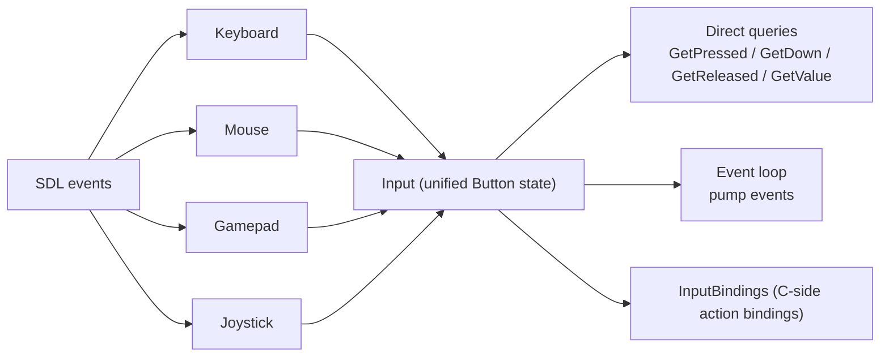
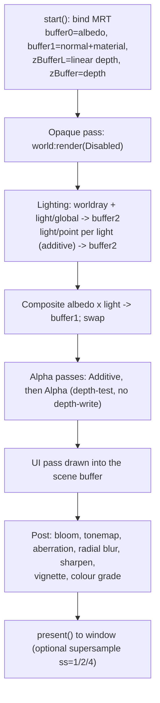
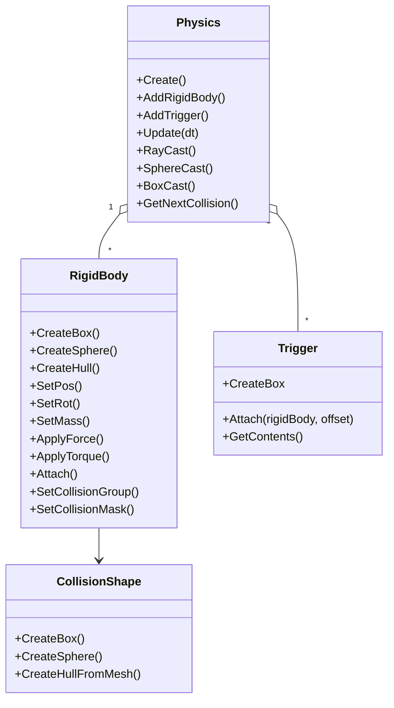

<!-- LimitTheory -->

# libphx subsystem guides

How each part of the engine is meant to be used, with Lua snippets drawn from the shipped scripts. Function names are the C names (`Module_Verb`); in Lua they become `Module.Verb(...)` or `obj:verb(...)` (see [LUA_BINDINGS.md](LUA_BINDINGS.md)). The complete list is in [API_REFERENCE.md](API_REFERENCE.md).

Contents: [Window](#1-window) · [Input](#2-input) · [Drawing](#3-immediate-drawing) · [Meshes](#4-meshes) · [Textures](#5-textures) · [Shaders](#6-shaders-and-shader-variables) · [Render targets and state](#7-render-targets-and-render-state) · [Renderer pipeline](#8-the-deferred-renderer-script-layer) · [Fonts and text](#9-fonts-and-text) · [HmGui](#10-hmgui-immediate-mode-gui) · [Physics](#11-physics) · [Spatial structures](#12-spatial-structures-and-geometry) · [Audio](#13-audio) · [Math/RNG/data](#14-math-random-and-data-types) · [Resources and files](#15-resources-files-and-time) · [Profiling](#16-profiling-and-metrics) · [Scheduler](#17-lua-scheduler) · [Sockets/threads/VR/MIDI](#18-networking-threads-vr-midi)

---

## 1. Window

`Window_Create(title, x, y, sx, sy, mode)` creates an SDL window **and** the OpenGL context requested in `Engine_Init`.

| Function | Notes |
|---|---|
| `Window_BeginDraw` / `Window_EndDraw` | Bracket a frame; `EndDraw` swaps buffers |
| `Window_SetVsync(bool)` | Game reads `Config.render.vsync` |
| `Window_Get/SetSize`, `Get/SetPosition`, `Get/SetTitle` | Query the size every frame for resizing (`Application` does) |
| `Window_ToggleFullscreen`, `SetFullscreen`, `Show`, `Hide` | |
| Constants | `WindowPos_Centered/Default`; `WindowMode_Shown, Resizable, Borderless, Fullscreen, Hidden, Maximized, Minimized, AlwaysOnTop` (flags; combine with `Bit.Or32`) |

```lua
local mode = Bit.Or32(WindowMode.Shown, WindowMode.Resizable)
local win  = Window.Create('Title', WindowPos.Centered, WindowPos.Centered, 1280, 720, mode)
win:setVsync(true)
```

## 2. Input

Two APIs, both built on the unified `Button` enum (every key, mouse button, gamepad button/axis, and `Button_System_Exit`).



| Concept | Behaviour |
|---|---|
| `Input.GetPressed(b)` | `true` only on the frame the button went down |
| `Input.GetDown(b)` | `true` while held |
| `Input.GetReleased(b)` | `true` on the release frame |
| `Input.GetValue(b)` | `[−1, 1]` axis value; buttons read 0/1, gamepad axes analog |
| Guarantee | Press/release always come in perfect pairs; device disconnect releases everything |
| Mouse | `Input.GetMousePosition()`, `GetMouseDelta()`, `GetMouseScroll()`; motion is not a button |
| Devices | `Input.GetActiveDeviceType/ID`, idle time; gamepad DB via `Input.LoadGamepadDatabase('gamecontrollerdb_205.txt')` |
| Modifiers | `Input.GetKeyboardCtrl/Shift/Alt` |

The game builds its own higher-level binding layer in Lua (`script/WIP/Control.lua`: `Key`, `Pair`, `Or`, `And`, `:delta()`, `:invert()`, `:setDeadzone()`…) — the C `InputBindings` API is a parallel, mostly unused alternative with deadzone/exponent/invert fluent setters.

## 3. Immediate drawing

`Draw` is a thin immediate-mode wrapper (GL compatibility profile). Draws are executed as you call them.

| Group | Functions |
|---|---|
| State | `Clear(r,g,b,a)`, `ClearDepth`, `Color`, `LineWidth`, `PointSize`, `PushAlpha/PopAlpha`, `SmoothLines/Points`, `Flush` |
| 2D | `Rect`, `Line`, `Point`, `Poly`, `Quad`, `Tri`, `Border` — coordinates in window pixels (origin top-left when a UI/ortho view is active) |
| 3D | `Axes`, `Box3`, `Line3`, `Plane`, `Point3`, `Poly3`, `Quad3`, `Sphere`, `Tri3` |

GL matrices are exposed through `GLMatrix` (`ModeP/ModeWV`, `Push/Pop`, `Load`, `Mult`, `Perspective`, `Clear`, …) and viewports/clip rects through `Viewport.Push/Pop` and `ClipRect.Push/Pop`.

## 4. Meshes

`Mesh` is an indexed triangle mesh with a vertex format (`position`, `normal`, `uv`), ref-counted.

```lua
local mesh = Mesh.Create()
mesh:addVertex(x, y, z, nx, ny, nz, u, v)   -- repeat
mesh:addTri(i0, i1, i2)                     -- or addQuad
mesh:computeNormals()                       -- or splitNormals() for hard edges
mesh:computeAO(radius)                      -- per-vertex ambient occlusion baking
mesh:transform(matrix) / :scale(x,y,z) / :rotateY(a) / :translate(x,y,z) / :center()
mesh:draw()                                 -- needs a shader bound
local obj = Mesh.Load('cube')               -- resolves res/mesh/cube.bin / .obj
```

| Related type | Purpose |
|---|---|
| `Meshes` | Generators: `Mesh.Box(res)`, `Mesh.BoxSphere(res)`, `Mesh.Plane(origin, du, dv, resU, resV)` |
| `BoxMesh` | Accumulate boxes into a single mesh (`BoxMesh_Add`, `GetMesh(res)`) |
| `LodMesh` | A set of meshes with distance thresholds; `Draw` picks a LOD |
| `Mesh_FromObj` / `Mesh_ToBytes` | `.obj` import, binary (LZ4-compressed) serialization |
| `SDF` | Signed-distance grid → `SDF_ToMesh` (surface extraction) |
| `Polygon`, `Triangle`, `Plane` | Geometry helpers (split, classify, clip) used by BSP/CSG |

## 5. Textures

| Type | Create/Load | Notes |
|---|---|---|
| `Tex1D` | `Create(size, format)`, `Load` | Lookup tables (color ramps) |
| `Tex2D` | `Create(sx, sy, format)`, `Load(name)` (jpg/png via stb) | `Save`, `ScreenCapture`, `GenMipmap`, `SetMagFilter/MinFilter/WrapMode/Anisotropy/MipRange`, `SetTexel`, `GetData/SetData`, `Clear`, `Draw/DrawEx`, `Push/Pop` (render into it) |
| `Tex3D` | `Create(sx, sy, sz, format)` | Volumes (SDF, noise) |
| `TexCube` | `Create`, `Load`, `GenMipmap`, `GenIRMap`, `GetData/SetData` per face | Environment/irradiance maps |

Enums: `TexFormat` (`R8`, `RGBA8`, `RGBA16F`, `R32F`, `Depth32F`, …), `TexFilter` (`Point`, `Linear`, `LinearMipmap…`), `TexWrapMode`, `PixelFormat`, `DataFormat`, `CubeFace`.

## 6. Shaders and shader variables

Shaders are GLSL 1.30 programs loaded **by name** from `res/shader/{vertex,fragment}/…`. The loader preprocesses two directives:

| Directive | Effect |
|---|---|
| `#include name` | Textually includes `res/shader/include/name.glsl` (library: `common, math, noise, pbr, lighting, scattering, texturing, fog, gamma, quat, random, raytrace, vertex, fragment, deferred, color, filter, bezier, brush, fdm, texcube`) |
| `#autovar <type> <name>` | Declares a uniform that is filled automatically from the **ShaderVar** stack at `Shader_Start` |

```glsl
// res/shader/vertex/wvp.glsl (excerpt)
#include vertex
#autovar mat4 mView
#autovar mat4 mProj
void main() { VS_BEGIN  vec4 wp = mWorld * vec4(vertex_position, 1.0); ... }
```

```lua
local s = Shader.Load('vertex/wvp', 'fragment/material/metal')   -- or Cache.Shader('wvp','material/metal')
s:start()
Shader.SetFloat3('lightColor', 1, 1, 1)       -- sets on the currently bound shader
Shader.SetTex2D('texAlbedo', albedo)
mesh:draw()
s:stop()

-- scoped, inherited values:
ShaderVar.PushFloat3('starDir', x, y, z)       -- visible to every shader started while pushed
ShaderVar.PushTexCube('envMap', envMap)
...
ShaderVar.Pop('starDir'); ShaderVar.Pop('envMap')
```

* **Uniform lookup** by name each call, or by index (`Shader_GetVariable` then `Shader_ISet*`) in hot paths.
* **Reload:** F5 in the game clears the shader cache (`Shader_ClearCache`, `Cache.Clear`).
* **ShaderState** captures a bound set of values for replay.

Shader library layout (in `res/shader/`):

| Directory | Contents |
|---|---|
| `vertex/` | `wvp` (world·view·proj), `wv`, `vp`, `worldray` (full-screen quad with world-space ray), `identity`, `ui`, `ui3D`, `uvspace`, `farplane`, `billboard/` |
| `fragment/material/` | `metal`, `solidcolor`, `alphacolor`, `asteroid`, `planet`, `atmosphere`, `ore`, `triplanar`, `uv_metal`, `devmat*` |
| `fragment/light/` | `global`, `point`, `composite` (deferred lighting passes) |
| `fragment/filter/`, `effect/` | Post-processing: bloom helpers, blur, tonemap, sharpen, aberration, radialblur, vignette, color grade |
| `fragment/gen/`, `brush/`, `uvbake/`, `compute/`, `sdf/` | Procedural texture/mesh generation |
| `fragment/ui/` | Widget shaders (box, circle, hex, grid, hologram…) |
| `fragment/skybox*`, `starbg`, `terrain`, `text`, `ptracer*` | Backgrounds, text, path tracer |

## 7. Render targets and render state

* `RenderTarget.Push(sx, sy)` starts a new framebuffer scope; `BindTex2D/3D/Cube(…, level)` attach colour/depth textures; `Pop()` restores. `PushTex2D(tex)` is the one-texture shortcut. Binding several colour textures yields MRT output for deferred rendering.
* Render state uses push/pop stacks: `BlendMode.Push(mode)`/`PushAdditive()`, `CullFace.Push`, `RenderState.PushDepthTest(bool)`, `PushDepthWritable`, `PushWireframe`, `PushAllDefaults/PopAll`, `ClipRect`, `Viewport`.
* `BlendMode`: `Disabled, Alpha, Additive, PreMultAlpha, …`. `CullFace`: `None, Back, Front`. `DepthTest`.
* Always **balance pushes and pops**; an imbalance leaks state into later draws.

## 8. The deferred renderer (script layer)

`script/phx/util/Renderer.lua` (used by the game's `GameView`) composes the primitives above into a deferred pipeline:



Tunables are registered as `Settings` (`render.fovY`, `render.superSample`, `postfx.*.enable/strength`, …) and appear in the debug window.

## 9. Fonts and text

`Font.Load(name, size)` rasterises a TTF/OTF with FreeType into a glyph atlas.

```lua
local f = Font.Load('NovaMono', 16)
f:draw('text', x, y, r, g, b, a)
local size = f:getSize('text')     -- measure (also getLineHeight, drawShaded)
```

Available fonts in `res/font/`: Abel, DejaVuSans(+Mono), Dosis (many weights), Exo2 (many weights), FiraMono, Iceland, Monaco, Nova{Flat,Mono,Round,Square}, Rajdhani, Share, ShareTech(Mono), TitilliumWeb, Ubuntu(+Mono)…

## 10. HmGui: immediate-mode GUI

`HmGui` is the engine's GUI toolkit ("Hmm GUI"): you describe the UI each frame; the engine does layout and hit-testing and returns interaction results.

```lua
function App:onUpdate (dt)
  HmGui.Begin(self.resX, self.resY)
    HmGui.BeginWindow('Settings')
      HmGui.Text('Volume')
      self.vol = HmGui.Slider(0, 1, self.vol)          -- returns the new value
      self.fx  = HmGui.Checkbox('Effects', self.fx)    -- returns the new bool
      if HmGui.Button('Apply') then self:apply() end   -- returns true when clicked
      HmGui.BeginGroupX()
        HmGui.Button('A'); HmGui.Button('B')
      HmGui.EndGroup()
      HmGui.SetAlign(0.5, 0.5); HmGui.SetStretch(1, 0)
    HmGui.EndWindow()
  HmGui.End()
end
function App:onDraw () HmGui.Draw() end
```

| API family | Functions |
|---|---|
| Frame | `Begin(sx, sy)`, `End()`, `Draw()` |
| Containers | `BeginGroupX/Y/Stack`, `EndGroup`, `BeginScroll(maxSize)`, `EndScroll`, `BeginWindow(title)`, `EndWindow` |
| Widgets | `Button`, `Checkbox`, `Slider`, `Text`, `TextColored`, `TextEx(font,…)`, `Rect`, `Image` |
| Layout | `SetAlign`, `SetStretch`, `SetSpacing`, `SetPadding[Ex/Left/Top/Right/Bottom]`, `GroupHasFocus` |
| Style stack | `PushStyle/PushFont/PushTextColor`, `PopStyle(depth)` |

The *retained* widget toolkit in `script/UI/*` (Canvas, Panel, Window, Button, Grid, NavGroup, …) is a separate, Lua-implemented system used by the game's menus; `ImGui` (41 functions) is a second immediate-mode wrapper used by `TestImGui`.

## 11. Physics

Bullet is wrapped behind four types.



Workflow (as used by `Game/Components/RigidBody.lua` and `Entities/System.lua`):

```lua
local physics = Physics.Create():managed()
local body    = RigidBody.CreateSphereFromMesh(mesh)
body:setMass(100); body:setPos(Vec3f(0, 0, 0)); body:setDrag(0.1, 1)
physics:addRigidBody(body)

-- every frame
body:applyForce(Vec3f(0, 0, 1000))
physics:update(dt)
local c = Collision()
while physics:getNextCollision(c) do  -- c.body0, c.body1, contact info
  ...
end
local hit = RayCastResult(); physics:rayCast(ray, hit)
```

Notes from the headers: only one level of parent/child (compound) attachment; children don't affect parent mass; `Trigger` is an AABB overlap volume with one frame of latency when attached; ray/shape casts return rigid bodies but not triggers; `Physics_Draw*` helpers render bounding boxes, triggers, wireframes for debugging; collision groups/masks are bit sets (`CollisionGroup`, `CollisionMask`).

## 12. Spatial structures and geometry

| Type | Use |
|---|---|
| `BSP` | Mesh BSP tree: `IntersectRay`, `IntersectLineSegment`, `IntersectSphere`; `BSPDebug_*` helpers for visualising nodes |
| `KDTree`, `Octree`, `BoxTree`, `HashGrid` | Point/box acceleration structures for broad phase and neighbour queries |
| `Intersect` | `PointBox`, `PointTriangle_Barycentric`, `RayPlane`, `RayTriangle_Moller1/2`, `RayTriangle_Barycentric`, `LineSegmentPlane`, `RectRect(Fast)`, `SphereTriangle` |
| `Ray`, `Plane`, `LineSegment`, `Triangle`, `Polygon`, `Box3`, `Sphere` | Primitives |
| `SDF` | Signed distance fields with mesh extraction |

## 13. Audio

FMOD-backed, 3D-aware. Initialise once, then create/play `Sound` objects and update the listener each frame.

```lua
Audio.Init()
Audio.Set3DSettings(0.0, 10, 2)                       -- doppler, distance scale, rolloff
local s = Sound.Load('engine_loop', true, true)       -- name, looped, is3D  (res/sound/*.ogg|wav|mp3|ogx)
s:setVolume(0.5); s:setPitch(1.0); s:play()
s:set3DPos(pos, vel)                                  -- or attach3DPos(pos, vel) to follow pointers
Audio.SetListenerPos(camPos, camVel, camFwd, camUp)
Audio.Update()                                        -- once per frame
Sound.LoadPlayFree('explosion', false, true)          -- fire-and-forget
```

`Sound_LoadAsync` loads in the background; sound assets unload automatically once all handles are freed. `Audio.GetLoadedCount/PlayingCount/TotalCount` feed the debug window.

## 14. Math, random and data types

| Module | Contents |
|---|---|
| `Vec2/Vec3/Vec4` (`f`,`d`,`i`) | Transparent structs; Lua operators from `ffiext` |
| `Quat`, `Matrix` | Quat: `FromAxisAngle`, `FromLookUp`, `FromBasis`, `Slerp/Lerp`, `Mul/MulV`, `Inverse`; Matrix: `Identity`, `Translation/Scaling/Rotation[XYZ]/YawPitchRoll/SRT`, `LookAt/LookUp`, `Perspective`, `Product/Inverse/Transpose`, `MulPoint/MulDir/MulBox`, `From{Quat,Basis,PosRot…}` |
| `Math` (`PhxMath`) | `Clamp/Clamp01/ClampSafe/ClampUnit`, `Round`, `Sign`, `PowSigned`, `Bezier3/4`, exponential maps `ExpMap`, `ExpMap1`, `ExpMap2` (+ `Signed`) |
| `RNG` | Seedable PRNG: uniform, int, gaussian, exp, Erlang, directions, sphere/disc points, quaternions, chance; `Create(seed)`, `FromTime`, `FromStr` |
| `Hash`, `GUID` | `FNV32/64`, `FNVStr32/64`, `Murmur3`, `XX64`; GUID create/exists |
| `Bytes`, `StrBuffer`, `StrMap`, `HashMap`, `MemPool`, `MemStack`, `Bit` | Data utilities |
| `Distribution` (Lua, `phx.util`) | Weighted sampling table used by procedural generators |

## 15. Resources, files and time

| Module | Notes |
|---|---|
| `Resource` | `AddPath`, `Exists`, `GetPath`, `LoadBytes`, `LoadCstr`; search templates per type ([ARCHITECTURE.md §6](ARCHITECTURE.md#6-resource-resolution)) |
| `File` | `Exists`, `IsDir`, `Size`, `ReadBytes/ReadCstr`, `Open/Close`, typed `ReadU8…ReadF64`, `WriteU8…WriteF64`, `WriteStr` |
| `Directory` | `Create`, `Remove`, `Change`, `GetCurrent`, `Open/GetNext/Close` iteration |
| `OS` | `GetClipboard/SetClipboard`, `GetCPUCount`, `GetVideoDriver` |
| `TimeStamp`, `Timer` | `TimeStamp.Get()`, `GetElapsed`, `GetDifference`, `GetFuture`; `Timer.Create/GetAndReset` |

## 16. Profiling and metrics

* `Profiler.Begin(name)` / `Profiler.End()` bracket scopes; `Profiler.SetValue(name, int)` records counters; `Profiler.LoopMarker()` ends a frame; `Profiler.Enable/Disable` (F10 in the game); `Profiler_Backtrace` is invoked from `Fatal`.
* `Metric.Get(Metric.DrawCalls | Immediate | PolysDrawn | TrisDrawn | VertsDrawn | Flush | FBOSwap)` return per-frame counters, reset by `Engine_Update`.
* The game displays these in the bottom bar (`Config.debug.metrics`).

## 17. Lua scheduler

`LuaScheduler` registers three globals in the host Lua state:

| Global | Meaning |
|---|---|
| `Schedule(fn, arg, delaySeconds)` | Run `fn(arg)` once, no earlier than `delay` seconds from now |
| `SchedulerUpdate()` | Run all due callbacks (call once per frame) |
| `SchedulerClear()` | Drop everything queued |

Single global instance (one Lua state only); implemented as a wake-time-sorted array.

## 18. Networking, threads, VR, MIDI

| Module | Notes |
|---|---|
| `Socket` | TCP/UDP: `Create(type)`, `Bind`, `Listen`/`Accept`, `Read`/`Write` (+bytes), `SendTo`/`ReceiveFrom` |
| `Thread`, `ThreadPool` | `Thread_Create/Detach/Wait/Sleep`; `ThreadPool_Create/Launch/Wait` |
| `VR` | 20 functions (`Init`, `GetProjection`, `GetEyeTransform`, device/controller queries, `Vibrate`, `Render`) — present in the API, not exercised by the game |
| `Midi` | `MidiDevice_GetCount/Open/Close/GetNameByIndex/HasMessage/PopMessage` |
| `Joystick`, `Gamepad` | Raw device access beneath `Input` |
