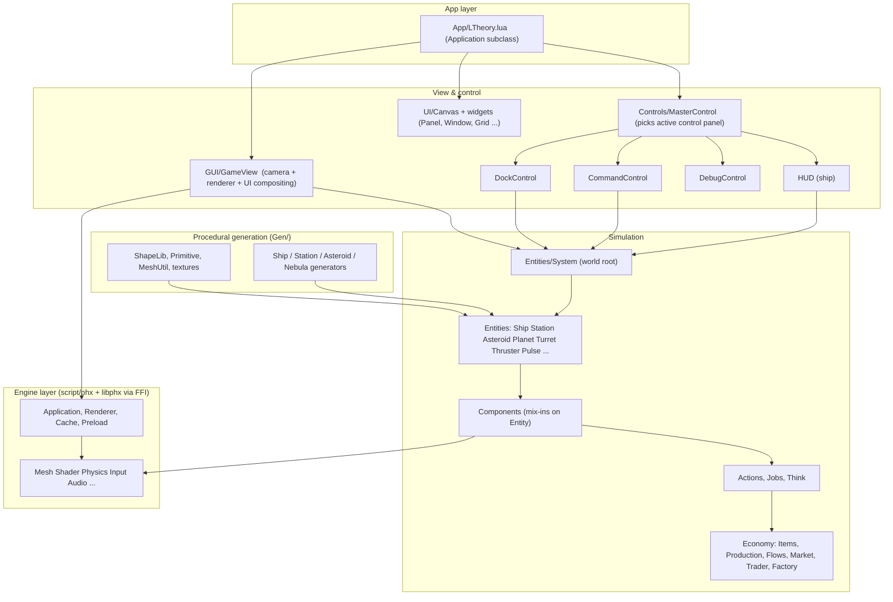
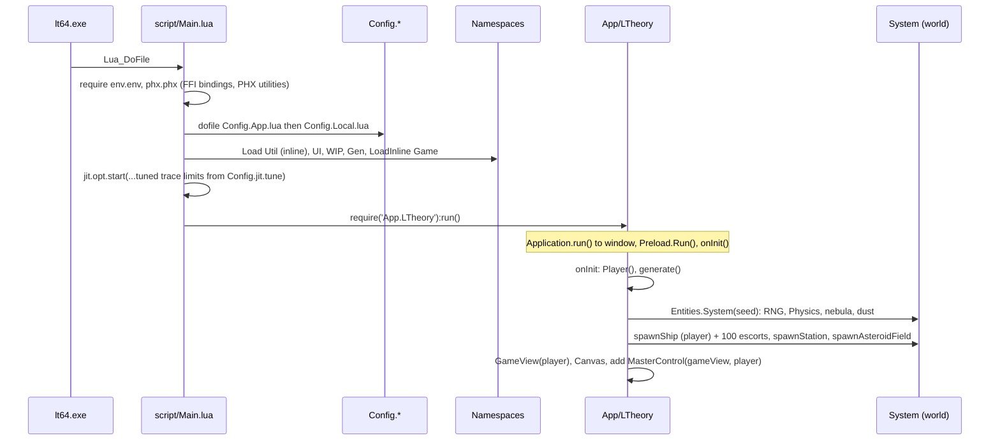
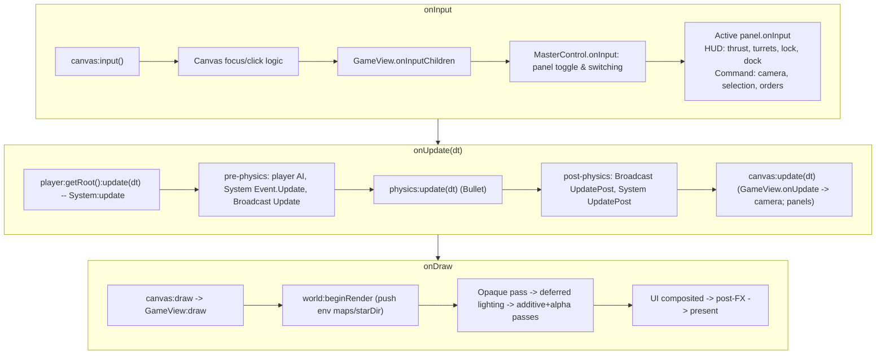
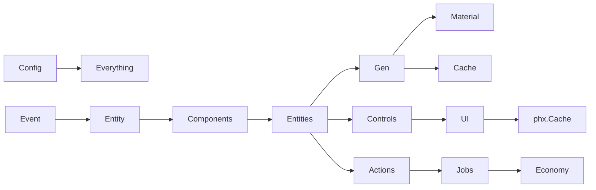

<!-- LimitTheory -->

# Game architecture

How the Lua game layer is organized and how a frame flows through it.

## 1. Layered view

Rules of thumb that fall out of the structure:

* **Simulation never imports view code.** Entities and components know nothing about HUD or UI; controls manipulate entities through component methods.
* **The world is a tree** rooted at an `Entities.System`. Everything physical is a child of the system (or of a station when docked).
* **Components are mix-ins**, not objects: `Entity:addHealth()` stores state fields on the entity and registers event handlers. Entities are plain Lua tables.
* **All behaviour is event driven**: the system broadcasts `Event.Update`, `Event.Render`, etc. down the tree; entities respond via registered handlers.

## 2. Start-up sequence

`LTheory:generate()` seeds a fresh `RNG` from the clock, creates the system, spawns the **player ship** at `Config.gen.origin` (frictionless, never sleeps), gives the player 100 **escort ships** with an `Escort` action, one station and an asteroid field (500 asteroids, 10 with ore).

## 3. The frame

### System update order in detail (`Entities/System.lua`)

1. Build `Event.Update(dt)`.
2. `player:send(event)` for every AI player (runs their action stack → `Think`).
3. `system:send(event)` — the system's own handlers (projectiles pre-physics, economy, flows).
4. `system:send(Event.Broadcast(event))` — `Broadcast` re-sends the wrapped event to **every child** (and recursively), so ships update thrust/health/capacitor/actions/etc.
5. `physics:update(dt)`.
6. `Event.UpdatePost(dt)` broadcast and sent: pulses ray-cast against the new physics state and apply damage.

### Render order (`GUI/GameView.lua`)

1. `world:beginRender()` – pushes `starDir`, `envMap`, `irMap` as shader variables.
2. **Opaque**: `world:render(Event.Render(BlendMode.Disabled, eye))` into the G-buffer (albedo, normal+material, linear depth).
3. **Lighting**: global (environment) light, then a point-light pass per light-bearing entity, then composite.
4. **Additive** pass (pulses, thrusters, effects) then **Alpha** pass (dust, nebula billboards; optional physics debug).
5. UI children (HUD, overlays) draw into the scene buffer.
6. Post: bloom, tonemap, aberration, radial blur, sharpen (each switchable via `Settings`) → present, then `GUI.DrawHmGui`.

## 4. Module dependency overview

* `Game.Components.*` all `require('Game.Entity')` and **extend the Entity class** by adding methods to it — requiring a component file installs its methods globally. `requireAll('Game.Components')` (done by `Game.Entities.Turret` etc.) loads them all.
* `Namespace.LoadInline('Game')` also injects entity/action modules into `_G` (`Entities`, `Actions`, `Controls`, `GUI`, `Jobs` …).

## 5. Responsibility map

| Concern | Where | Notes |
|---|---|---|
| App lifecycle | `phx/util/Application.lua`, `App/LTheory.lua` | Window, loop, global keys |
| World & update/render dispatch | `Game/Entities/System.lua` | Owns RNG, Physics, Nebula, Dust, projectiles, economy |
| Entity base | `Game/Entity.lua` | Id, handler table, `register`, `send`, `delete` |
| Capabilities | `Game/Components/*` | health, rigid body, sockets, inventory, AI action stack, … |
| Gameplay intent | `Game/Controls/*` | Reads bindings, drives components |
| AI | `Game/Actions/*`, `Game/Jobs/*` | Action *stack* per entity; `Think` assigns Jobs |
| Economy model | `Game/Item,Production,Flow,Market,Trader,Factory,Economy` | Flow-pressure job selection |
| Content | `Game/Content.lua`, `Gen/*`, `res/*` | Items/recipes, procedural meshes/textures |
| Rendering | `GUI/GameView`, `phx/util/Renderer`, `Game/Material`, entity `Render` handlers | Deferred pipeline |
| UI | `UI/*`, `GUI/*` | Retained widgets + engine HmGui |
| Config/settings | `Config.*.lua`, `env/util/Settings.lua` | Static tables + runtime-tunable settings |
