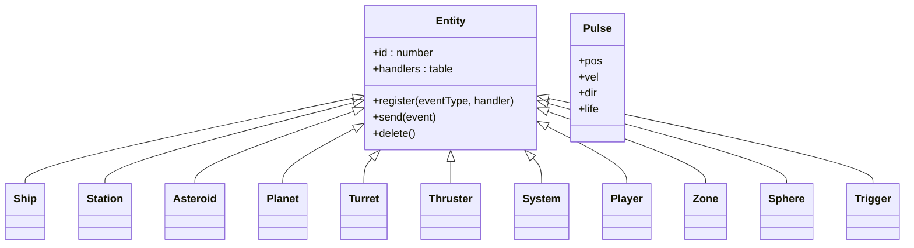
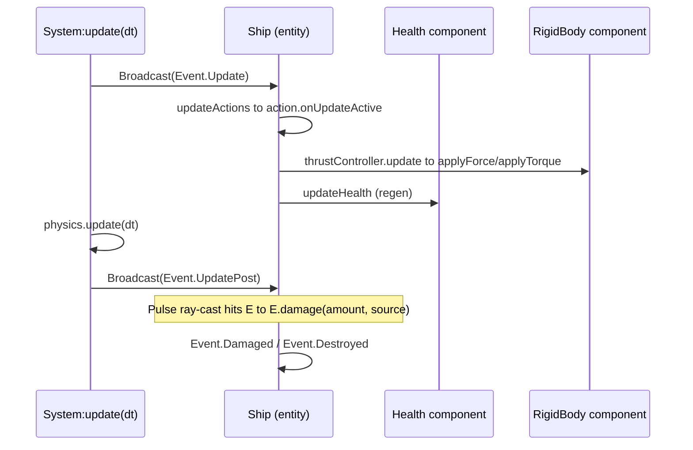
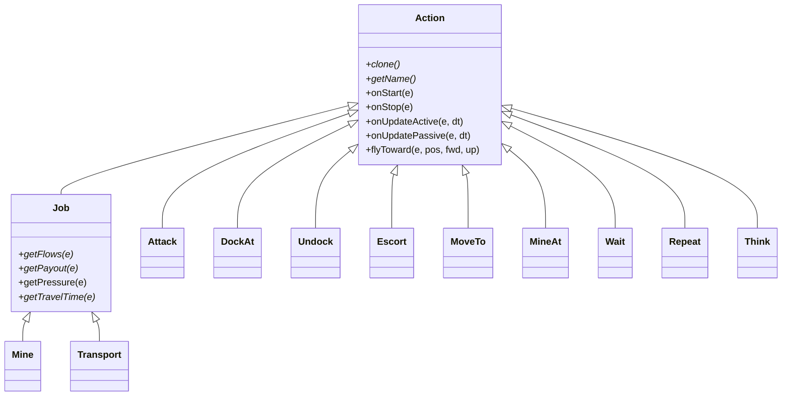
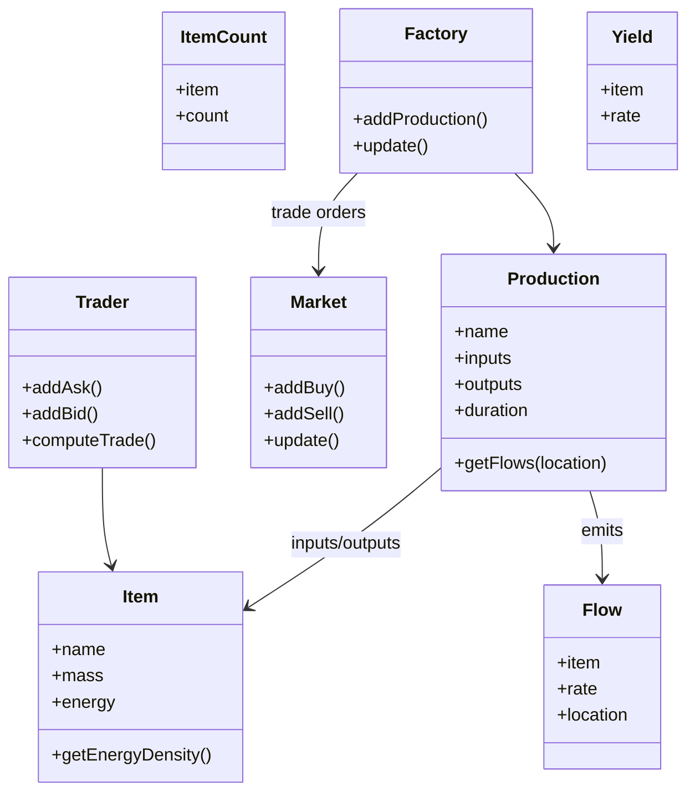

<!-- LimitTheory -->

# Data structures

The central data model of the game: entities, components, events, actions, the economy model, configuration and the support containers.

## 1. Entity

`script/Game/Entity.lua` (31 lines) is the whole base class:

```lua
local Entity = class(function (self)
  self.id = id            -- process-unique, increasing integer
  self.handlers = {}      -- eventType -> list of handler functions
end)

function Entity:delete () self.deleted = true end
function Entity:register (eventType, handler) ... end   -- append a handler
function Entity:send (event) ... end                    -- call handlers; unwrap Broadcast
```

An entity is **just a Lua table**: its capabilities are plain fields added by components (`self.health`, `self.body`, `self.children`, …). There is no component container, no archetype and no ECS scheduler — event handlers *are* the systems.



### Entity types (`Game/Entities`)

| Type | Role | Components it installs |
|---|---|---|
| `System` | World root: RNG, `Physics`, nebula, dust, players, zones | Children, Projectiles, Economy, Flows |
| `Ship` | Flyable vessel built from a `ShipType` | Actions, Capacitor, Children, Explodable, Health, Inventory, RigidBody, Sockets, VisibleMesh, ThrustController |
| `Station` | Dockable structure; may host Market/Trader/Factory | Actions, Capacitor, Children, Dockable, Flows, Health, Inventory, RigidBody, VisibleMesh |
| `Asteroid` | Mineable rock with LOD mesh; optional `Yield` | RigidBody, VisibleLodMesh |
| `Planet` | Large sphere body | RigidBody |
| `Turret`, `Thruster` | Socket attachments (`SocketType.Turret/Thruster`) | RigidBody, VisibleMesh |
| `Pulse` | Plasma projectile — **not** an Entity table but a `CType.Struct` pooled in `system.projectiles` | — |
| `Player` | Human or AI owner of assets; holds the controlled ship | Actions, Assets, Dispositions, Inventory |
| `Zone` | Named group of entities (asteroid field) | — |
| `Nebula`, `Dust`, `Explosion`, `Sphere`, `Trigger` | Environment/effect/helper entities | varies |

## 2. Components

A component is a file in `script/Game/Components/` that **adds methods to `Entity`** and registers handlers. Conventions (observed uniformly):

| Method | Meaning |
|---|---|
| `Entity:addX(...)` | Install the component; asserts it isn't already installed; initialises fields; registers event handlers |
| `Entity:hasX()` | Is it installed? |
| `Entity:getX()` / getters | Access (assert installed) |
| `Entity:debugX(state)` | `Event.Debug` handler that prints to a debug context |
| `Entity:updateX(state)` | `Event.Update` handler |

| Component | State stored on the entity | Key API | Events it handles |
|---|---|---|---|
| **Children** | `children`, `parent` | `addChild`, `removeChild`, `getParent`, `getRoot`, `iterChildren` | `Broadcast` (forward to children); emits `ChildAdded/Removed`, `AddedToParent/RemovedFromParent` |
| **RigidBody** | `body` (engine `RigidBody*`) | `setPos/getPos`, `setRot`, `setScale`, `setMass`, `applyForce[Local]`, `applyTorque[Local]`, `getVelocity`, `attach/detach`, `toWorld/toLocal`, bounding queries, `setDrag`, `setFriction`, `setCollisionGroup/Mask` | `AddedToParent` (adds body to parent's `physics`), `RemovedFromParent` |
| **Health** | `health`, `healthMax`, `healthRate` | `damage`, `getHealth*`, `isAlive`, `isDestroyed` | `Update` (regen); emits `Damaged`, `Destroyed` |
| **Capacitor** | `charge`, `chargeMax`, `chargeRate` | `discharge`, `getCharge*`, `setCharge` | `Update` (recharge) |
| **Inventory** | `inventory` (item→count), `inventoryCapacity`, `inventoryFree` (by mass) | `addItem`, `removeItem`, `getItemCount`, `hasItem` | Debug |
| **Credits** | credit balance | `addCredits`, `removeCredits` | — |
| **Sockets** | `sockets` list of `Socket`, aggregate turret range/speed | `addSocket`, `plug(child)`, `unplug`, `iterSocketsByType` | — |
| **Actions** | `actions` stack | `pushAction`, `popAction`, `getCurrentAction`, `clearActions`, `isIdle` | `Update` (runs the stack), Debug |
| **ThrustController** | `thrustController` {forward,right,up,yaw,pitch,roll,boost} | `getThrustController`, `setThrust` | `Update` (applies forces), `Destroyed` |
| **Target** | `target` | `setTarget/getTarget` | — |
| **Owner** | `owner` | `setOwner/getOwner/getOwnerRoot/getOwnerDisposition` | — |
| **Dispositions** | `dispositions` target→[-1,1] | `getDisposition`, `isFriendlyTo`, `isHostileTo`, `modDisposition` | — |
| **Assets** | `assets` list | `addAsset`, `removeAsset`, `getAssets` | — |
| **Dockable** | `dockable` flag | `addDockable`, `addDocked(e)`, `removeDocked`, `getDocked` | `Destroyed` (damages occupants) |
| **VisibleMesh / VisibleLodMesh** | `mesh`/`lodMesh`, `material` | — | `Render` (Disabled/opaque pass) |
| **Light** | `light` color | `addLight/setLight/getLight` | — (read by GameView) |
| **Explodable** | `explodable` flag | `hasExplodable` | `Destroyed` → removes itself from its owner's assets, spawns 8 `Explosion` entities around itself, clears its action stack |
| **Trigger** | `trigger` | `triggerAttach/Detach`, `getContents` | — |
| **Projectiles** | `projectiles` array of `Pulse` structs | `addProjectile(source)`, `renderProjectiles` | `Update` (pre- and post-physics) |
| **Flows** | `flows` item→rate | `getFlow`, `setFlow`, `modFlow`, `getFlows` | Debug |
| **Economy** | `economy` object (caches factories, markets, traders, yields, jobs) | `getEconomy` | `Update` (rebuild caches/jobs) |
| **Market** | `marketData` (item→buy/sell order books), escrow | `addMarket`, `addBuy`, `addSell` | `Update` (match orders) |
| **Trader** | bids/asks per item, `tradeData` | `addTrader`, `addAsk/addBid`, `getBuyFromPrice`, `getSellToPrice`, `computeTrade`, `buy/sell` | `Update` |
| **Factory** | production list, uptime counters | `addFactory`, `addProduction(prod)`, `isBlocked`, `getUptime` | `Update` (progress production) |
| **Yield** | `yield` {item, rate} | `addYield(item, rate)`, `getYield` | — |
| **Name** | `name` | `getName` (falls back to `Entity @ <ptr>`), `setName`, `__tostring` | — |
| **Messages** | `messages` list | `addMessages`, `addMessage(fmt, ...)`, `getMessages` | — |

### Component interaction patterns



## 3. Events (`Game/Event.lua`)

Events are plain tables `{ type = Event.X, ... }` created by constructor functions; the **function itself is the type key**.

| Event | Fields | Sent when |
|---|---|---|
| `Update` / `UpdatePost` | `dt` | each frame before / after physics |
| `Render` | `mode` (BlendMode), `eye` | each render pass |
| `Broadcast` | `event` | wrap an event to deliver it to the whole subtree |
| `ChildAdded` / `ChildRemoved` | `child` | container changes |
| `AddedToParent` / `RemovedFromParent` | `parent` | entity attached/detached |
| `Damaged` | `amount`, `source` | `Entity:damage` |
| `Destroyed` | (`source`) | health reached 0 |
| `Debug` | `context` | debug window asks for a text dump |

## 4. Actions and jobs



* Each entity with the **Actions** component owns an **action stack**. `pushAction` calls `onStart`; the stack's top action gets `onUpdateActive`, **every** action gets `onUpdatePassive`; `popAction` calls `onStop`. Stack depth limit 1024.
* `Action` subclasses implement `clone` (clean copy for `Repeat`), `getName`, lifecycle hooks, and use `Action:flyToward` to steer through the thrust controller.
* `Job` is an `Action` that additionally declares **flows** (items/second to/from locations), a **payout** and **travel time**; `getPressure` compares a job's flows against current flow levels so `Think` can pick the job that relieves the most shortage.

| Action | Behaviour |
|---|---|
| `MoveTo(target, range)` | Fly toward a target until within range |
| `Attack(target)` | Pursue and fire turrets (uses `Config.game.aiFire`) |
| `Escort(target, offset)` | Hold a position relative to a leader |
| `DockAt(target)` | Fly to a dockable and call `addDocked` |
| `Undock()` | Leave the station |
| `MineAt(target)` | Mine an asteroid with a `Yield` |
| `Wait(seconds)`, `Repeat(action)` | Control flow helpers |
| `Think()` | Per-player manager that assigns the best `Job` to idle assets |

## 5. Economy model



* **`Item(name, mass, energyDensity)`** — registered in a global list; `Item.Credit` is the zero-mass currency. Defined in `Game/Content.lua`: Energy Cell, Radioactive Isotopes, Silver, Radioactive Waste; tiers `Item.T1` (raw: Isotopes, Silver) and `Item.T2`.
* **`Production(name)`** — `:addInput(item, n)`, `:addOutput(item, n)`, `:setDuration(s)`; converts to `Flow`s of `±n/duration`. Registered globally (`Production.All()`): *Solar Energy Array*, *Nuclear Reactor*, …
* **`Flow(item, rate, location)`** — a rate of an item entering (+) or leaving (−) an entity; entities track aggregate `flows` (the **Flows** component) so the system can see the net balance.
* **Market** — per-item order books (`ordersBuy` sorted ascending, `ordersSell` descending); matching when best sell ≤ best buy.
* **Trader** — simpler bid/ask quoting used by `Jobs`.
* **Economy** (on the System) — rebuilds lists of factories, flows, markets, traders and yields each update, and the candidate `Mine(src, dst)` jobs for every yield→market pair.

## 6. Generation data

| Structure | Where | Meaning |
|---|---|---|
| `ShipType(seed, generator, scale)` | `Game/ShipType.lua` | Cached generated hull `mesh`, `bsp`, `scale` and mount `sockets` (turret/thruster positions found by `GenUtil.FindMountPoint`) → `instantiate()` creates a `Ship` |
| `Socket(type, pos, external)` / `SocketType` | `Game/Socket*.lua` | Mount point; `child` set on `plug` |
| `Material(name, diffuse, normal, spec)` | `Game/Material.lua` | Shader + texture set; `start/stop/setState(e)` binds textures and uniforms |
| `Distribution` | `phx/util/Distribution.lua` | Weighted sampler (`add(value, weight)`, `sample(rng)`) used for names and generator choice |
| `Gen.Generator` | `Gen/Generator.lua` | Registry: `Add(type, weight, fn)`, `Get(type, rng)` |
| `SystemGenerator` | `Gen/SystemGenerator.lua` | Builds a `System` with fields/stations/planets from Config |
| Name grammar | `res/grammar/*.txt` | Word lists for procedural names |

## 7. Configuration data

All config is Lua tables loaded at start-up: `Config.App.lua` (defaults) then `Config.Local.lua` (overrides). Key groups:

| Table | Typical keys |
|---|---|
| `Config.app` | name of the App to run (`'LTheory'`) |
| `Config.debug` | `metrics`, `window`, `windowSection`, `timeAccelFactor`, `instantJobs`, `jobSpeed`; `.physics.draw*` |
| `Config.gen` | seeds (`seedGlobal`, `seedSystem`), `origin`, counts (`nFields`, `nStations`, `nPlanets`, `nNPCs`, `nTurrets`, `nThrusters`), `nFieldSize(rng)`, `nStars(rng)`, resolutions (`shipRes`, `nebulaRes`), scales |
| `Config.game` | weapon (`pulseDamage/Size/Speed/Range/Spread`, `rateOfFire`), ship (`shipEnergy`, `shipEnergyRecharge`, `shipHealth`, `shipHealthRegen`, `boostCost`), AI (`aiUsesBoost`, `aiFire`), `dockRange`, `invertPitch`, `autoTarget`, spawn counts |
| `Config.render` | `fullscreen`, `vsync` |
| `Config.ui` | `showTrackers`, `defaultControl`, `controlBarHeight`, `color.*`, `font.*` |
| `Config.jit` | LuaJIT tuning (`tune.maxTrace`, `hotLoop`, …), `profile`, `verbose`, `dumpasm` |

Runtime-tunable values use `Settings` instead (`Settings.addFloat('render.fovY', 'FOV', 70, 50, 100)`), which the debug window renders automatically.

## 8. Support containers and helpers

| Container | Location | Notes |
|---|---|---|
| `List` | `env/util/List.lua` | Array wrapper with ~60 functional helpers (`filter`, `map`, `find`, `union`, `difference`, `removeFast`, `choose(rng)`, …). Used heavily by controls |
| `Map`, `MapList` | `env/util/` | Associative helpers |
| `TrackingList(context, predicate)` | `Util/TrackingList.lua` | Auto-updating list of root children matching a predicate; listens for `ChildAdded/Removed` on the root |
| `CType.Struct`/`CArray`/`CPointer` | `phx/util/C*.lua` | Define FFI-backed packed structs (used for `Pulse`) and pooled arrays for performance |
| `IncRef/DecRef/Deref` | `env/util/Ref.lua` | Integer ids for Lua objects so C structs (pulses) can reference them; the global table keeps the object reachable (not GC'd) until the count drops to zero |
| `Event`/`EventManager` | `Game/Event.lua`, `env/util/` | Event constructors; manager for global events (`SendEvent('Engine.Reload')`) |
| `Color`, `Cache` | `phx/util/` | Colour value type; resource caches |
