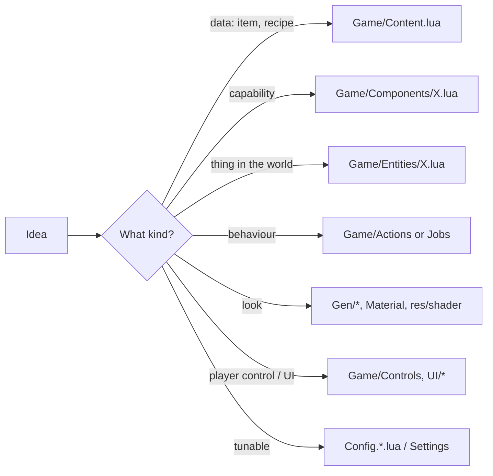

<!-- LimitTheory -->

# Extending the game

Recipes for adding content and behaviour. Each recipe names the files to touch and the contract to follow. Everything here is Lua — no engine rebuild is needed unless you add C functions (see [`../Engine/EXTENDING.md`](../Engine/EXTENDING.md)).

> **Worked example.** [`examples/ExtendDemo.lua`](examples/ExtendDemo.lua) combines recipes 1–4 below (new item + recipe, new component, new action, hook into world generation). Copy it to `script/App/ExtendDemo.lua` and run `bin\lt64.exe ExtendDemo`. It was run on this machine: the console prints `[Ping] Demo Escort started`, `Productions registered: 3, Plasma Gel mass 2.0`, and `[Ping] … done after 2.0s, beacon age 2.0`.



## Conventions

* One concept per file; the file name equals the type name (`Game/Entities/Ship.lua`, `Game/Actions/Wait.lua`).
* Modules `return` their class/table; use `local X = require('Game.X')`.
* Class helpers: `class(ctor)`, `subclass(base, ctor)` — constructors receive `self`; subclass constructors run after the base constructor.
* `Namespace.LoadInline('Game')` makes `Entities`, `Actions`, `Controls`, `GUI`, `Jobs` globals; files dropped into those directories are picked up automatically by `requireAll`.
* `GlobalRestrict` is on: do not create accidental globals; declare `local`.
* Use `Profiler.Begin/End` around anything that runs per frame.
* Follow component idiom: `addX`, `hasX`, `getX`, `updateX`, `debugX`.

## 1. Add an item and a production recipe

Edit `Game/Content.lua` (or hook in from your own file like the demo):

```lua
local Item = require('Game.Item')
local Production = require('Game.Production')

Item.PlasmaGel = Item('Plasma Gel', 2, 3.0)        -- name, mass, energy density

Production.GelSynth = Production('Gel Synthesizer')
  :addInput(Item.Isotopes, 1)
  :addOutput(Item.PlasmaGel, 2)
  :setDuration(2)
```

Any station given `station:addFactory(); station:addProduction(Production.GelSynth)` will run it. `System:spawnStation()` picks a random entry of `Production.All()`, so new recipes appear in generated stations automatically. For raw materials, add to `Item.T1` so asteroids may carry them (`insert(Item.T1, Item.X)`).

## 2. Add a component

```lua
-- Game/Components/Shield.lua
local Entity = require('Game.Entity')

function Entity:addShield (max, rate)
  assert(not self.shield)                    -- guard against double install
  self.shield = max
  self.shieldMax = max
  self.shieldRate = rate
  self:register(Event.Update, Entity.updateShield)
  self:register(Event.Debug,  Entity.debugShield)
end

function Entity:hasShield () return self.shield ~= nil end

function Entity:updateShield (state)
  self.shield = min(self.shieldMax, self.shield + self.shieldRate * state.dt)
end

function Entity:debugShield (state)
  local ctx = state.context
  ctx:text('Shield: %.0f / %.0f', self.shield, self.shieldMax)
end
```

Then call `ship:addShield(100, 5)` in the entity's constructor or after spawning. Because `Game.Entities.*` use `requireAll('Game.Components')`, a new file in that folder is loaded automatically.

Checklist:

- [ ] `assert(not self.x)` in `addX`
- [ ] Register handlers with `self:register(Event.X, fn)`; handlers have signature `fn(self, event)`
- [ ] Do not store per-frame garbage; reuse tables
- [ ] Unregister nothing — handlers die with the entity; if you hold external references, clear them in an `Event.Destroyed` handler
- [ ] Add a `debugX` handler for the debug window

## 3. Add an entity type

```lua
-- Game/Entities/Mine.lua : a stationary explosive
local Entity   = require('Game.Entity')
local Material = require('Game.Material')

local Mine = subclass(Entity, function (self, mesh)
  self:addActions()                     -- Explodable calls clearActions(): Actions is a dependency
  self:addChildren()                    -- needed if it can contain / receive Broadcast events
  self:addHealth(10, 0)
  self:addExplodable()
  self:addRigidBody(true, mesh)         -- collision shape built from the mesh
  self:addVisibleMesh(mesh, Material.Metal())
  self:setDrag(0, 0)
  self:setScale(3)
  self:setMass(50)
end)

return Mine
```

Spawn it in a system (verified on this machine: spawns, takes damage, is destroyed):

```lua
local mesh = Mesh.Box(4):managed()         -- any engine Mesh; create once and share
local mine = Entities.Mine(mesh)           -- `Entities` is global once Game.Entities is loaded
mine:setPos(Vec3f(100, 0, 0))
system:addChild(mine)                      -- AddedToParent handler registers its body with physics
mine:damage(100, nil)                      -- -> Event.Destroyed -> explosions, asset removal
```

Rules and gotchas:

* **Parent it** to a `System` (or other container) — that registers the body with physics and puts it in the update/render traversal.
* **Component dependencies are implicit.** Known ones: `Explodable → Actions` (and uses `getOwner`), `Dockable → Children`, `RigidBody` needs a parent with `physics` to simulate, `Sockets` + `Turret/Thruster` children need `RigidBody`. An `assert(self.actions)` failure from inside another component is the usual symptom.
* Create meshes once and share them (see `Asteroid`'s `getMesh` cache); engine meshes must be `:managed()` or retained by you.
* `entity:delete()` marks it; `parent:removeChild(entity)` removes its physics body.
* Procedural meshes with degenerate polys print `Bad normal at poly` / `BSP Incoming Mesh Error`; these are warnings from the engine's mesh validation.

## 4. Add an AI action

```lua
-- Game/Actions/Patrol.lua
local Action = require('Game.Action')

local Patrol = subclass(Action, function (self, points)
  self.points = points
  self.index = 1
end)

function Patrol:clone ()               -- clean copy (used by Repeat)
  return Patrol(self.points)
end

function Patrol:getName () return 'Patrol' end

function Patrol:onUpdateActive (e, dt)
  local p = self.points[self.index]
  local to = p - e:getPos()
  if to:length() < 100 then
    self.index = self.index % #self.points + 1
  else
    self:flyToward(e, p, e:getForward(), e:getUp())   -- helper from Action
  end
end

return Patrol
```

Use: `ship:pushAction(Actions.Patrol({ Vec3f(0,0,500), Vec3f(500,0,0) }))`. Stack actions with `Repeat`/`Wait`. Pop with `e:popAction()` when finished (the top action gets `onUpdateActive`, all get `onUpdatePassive`).

Expose it to the player: add an entry to `ContextEntries` in `Game/Controls/CommandControl.lua`:

```lua
{
  GetContextEntry = function () return UI.Button('Patrol') end,
  GetActionArgs   = function () return nil end,
  GetDetailsEntry = function (args) return nil end,
  GetAction       = function (target, args) return Actions.Patrol({ target:getPos() }) end,
},
```

## 5. Add an economy job

Subclass `Game/Job` and implement `clone`, `getName`, `getFlows(e)` (list of `Flow`), `getPayout(e)`, `getTravelTime(e)` and `onUpdateActive`. Register candidates in `Economy:update` (see how `Jobs.Mine(src, dst)` is generated for every yield→market pair). `Think` will consider anything in `economy.jobs`.

## 6. Generate new content procedurally

| Goal | Where / how |
|---|---|
| New ship hull | Add a function to `Gen/ShipFighter.lua` (e.g. `ShipFighter.Needle(rng)`) returning `shape:finalize()`; select it in `Gen/Ship.lua` (`Ship.ShipFighter`) or make a new top-level generator and pass it to `ShipType(seed, generator, scale)` |
| New shape primitive | `Gen/ShapeLib/*` — build `Shape` objects (`verts` + `polys`), combine with `add`, transform with `Warp`/`Joint` |
| New nebula style | New file in `Gen/Nebula/` that ends with `Generator.Add('Nebula', weight, fn)` where `fn(rng, res, starDir)` returns a `TexCube`; also add a shader under `res/shader/fragment/gen` if GPU generated |
| New asteroid look | `Gen/Asteroid.lua` + `Material.Rock()` / a new `Material` |
| New station | Implement a generator like `Gen/StationOld.lua` and use it in `Entities/Station.lua` |
| New names | Add word lists to `res/grammar/*.txt` and/or `Distribution`s as in `System.lua`'s `genName` |

Always derive randomness from the passed `rng` (never `math.random`) so seeds reproduce.

## 7. Add a control panel (new player mode)

```lua
-- Game/Controls/ResearchControl.lua
local ResearchControl = {}
ResearchControl.__index = ResearchControl
setmetatable(ResearchControl, UI.Panel)
ResearchControl.name = 'Research'

function ResearchControl:onEnable ()
  self.gameView:setOrbit(true)
  self.gameView.camera:warp()
end

function ResearchControl:onInput (state)  end
function ResearchControl:onUpdate (state) end
function ResearchControl:onDraw (focus, active) end
function ResearchControl:onDrawIcon (iconButton, focus, active)
  UI.DrawEx.RectOutline(iconButton:getRectGlobal())   -- draw a symbol in the selector bar
end

function ResearchControl.Create (gameView, player)
  local self = setmetatable({
    gameView = gameView, player = player, icon = UI.Icon(), children = List(),
  }, ResearchControl)
  self.icon:setOnDraw(function (ib, focus, active) self:onDrawIcon(ib, focus, active) end)
  return self
end

return ResearchControl
```

Register it in `Game/Controls/MasterControl.lua`: require it and add `{ name = 'Research', ctor = ResearchControl }` to the right control set's `controls` list; bind a number key in `MasterBindings.Controls` (currently three slots: **1/2/3**; add `N4`). Add your input actions in a new `*Bindings.lua` using `WIP.Control` combinators, and document them in `Docs/CONTROLS.md`.

## 8. Add UI

Retained toolkit (in-game windows):

```lua
local win = UI.Window('My Window', true)        -- title, draggable?
  :add(UI.NavGroup()
    :add(UI.Grid():setCols(1)
      :add(UI.Label('Hello'))
      :add(UI.Button('Do it', function (button) print('clicked') end))
      :add(UI.Slider(getter, setter, min, max))
      :add(UI.Checkbox(getter, setter))))
win:setAlign(1, 0)                               -- top-right
canvas:add(win)                                  -- or panel:add(win, false)
```

Immediate-mode (tools): `HmGui.Begin/BeginWindow/Button/Slider/Text/…/End` as in `script/App/TestHmGui.lua` (see [Engine SUBSYSTEMS §10](../Engine/SUBSYSTEMS.md#10-hmgui-immediate-mode-gui)).

Use `Config.ui.color.*` and `UI.DrawEx` helpers for consistent styling.

## 9. Add tunables and settings

* Static: add keys to `Config.App.lua` and read them as `Config.game.myKey`; override in `Config.Local.lua`.
* Runtime-adjustable: `Settings.addFloat('game.myKey', 'My Key', default, min, max)` (or `addBool`/`addEnum`) at module load; read with `Settings.get('game.myKey')`. The debug window shows it automatically.

## 10. Add a new app / scene

Create `script/App/MyApp.lua` returning an `Application()` subclass; run `bin\lt64.exe MyApp`. To reuse the game world, `require('App.LTheory')` and override `generate`, `onInit`, etc. exactly as `examples/ExtendDemo.lua` does.

## 11. Shaders and materials for the game

1. Add `res/shader/fragment/material/<name>.glsl` (GLSL 1.30; include `common`, `lighting`, `pbr` …).
2. Create a material: `Material.Create('material/<name>', Cache.Texture('metal/01_d'), Cache.Texture('metal/01_n'), Cache.Texture('metal/01_s'))`.
3. Assign it to an entity with `addVisibleMesh(mesh, material)`.
4. F5 reloads shaders and `Material:reload()` rebinds uniforms.

## 12. Debugging your extension

| Technique | How |
|---|---|
| Print | `printf('x = %d', x)`; `tostring` is patched to show functions/cdata nicely |
| Entity state | add `debugX`; open the Debug window |
| Wrong global | `GlobalRestrict` will throw `Attempt to access undefined global variable` |
| Hot reload | F5, then re-run your scenario (note: already-loaded modules are not re-required) |
| Profiling | wrap hot code in `Profiler.Begin('Name')/End()`; F10 toggles collection |
| Determinism | set `Config.gen.seedGlobal`/`seedSystem` or hardcode `self.seed` in `LTheory:generate` |
| Console noise | The stock game prints many benign messages (`Bad normal at poly`, `Shader_BindVariables: Automatic shader variable … does not exist`, `BSP Incoming Mesh Error`); real failures print `ERROR:` with a Lua stack |
