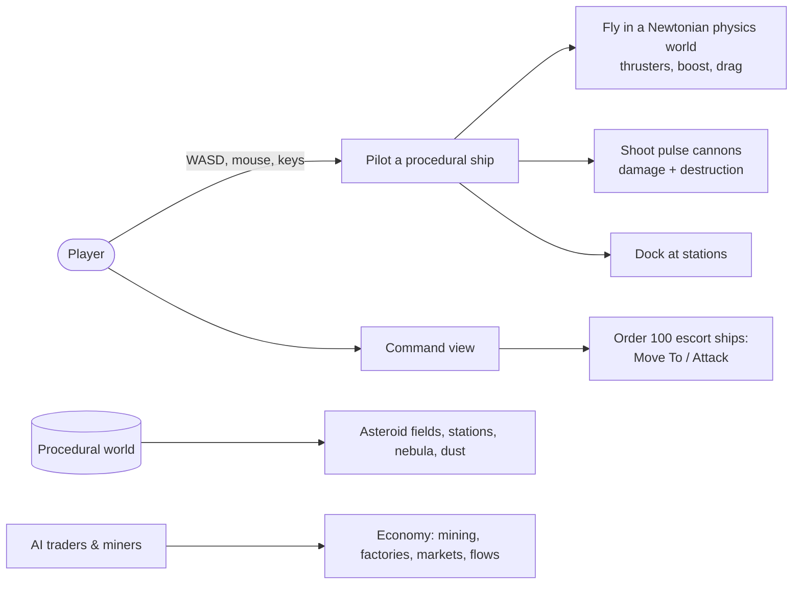

<!-- LimitTheory -->

# Limit Theory — source code documentation

Documentation of the **game layer** (`script/`, Lua) of the open-source *Limit Theory* repository. The C engine underneath is documented separately in [`../Engine/`](../Engine/README.md).

> *Limit Theory* was a (now cancelled) open-world space-simulation game by Josh Parnell. This repository is the "second generation" code base — C engine + Lua game — and is a **technical prototype**, not a finished game. This documentation describes what the code does today and calls out unfinished parts honestly.

## Documents

| Document | Contents |
|---|---|
| **README.md** (this file) | Overview, feature status, repo map, how the pieces fit |
| [USER_GUIDE.md](USER_GUIDE.md) | Running, playing, configuring (links to build/run/controls docs) |
| [ARCHITECTURE.md](ARCHITECTURE.md) | Layers, boot sequence, frame loop, update/render order, module map |
| [DATA_STRUCTURES.md](DATA_STRUCTURES.md) | Entity, components, events, actions, items/production, config, containers, generated data |
| [SYSTEMS.md](SYSTEMS.md) | Gameplay systems in depth: flight, combat, docking, AI/economy, procedural generation, controls, UI toolkit, rendering |
| [TECHNICAL_DESIGN.md](TECHNICAL_DESIGN.md) | Technical Design Document: goals, design decisions & trade-offs, performance notes, known issues/tech debt, roadmap |
| [EXTENDING.md](EXTENDING.md) | How to add entities, components, actions, jobs, items, ships, controls, UI, settings, apps |
| [GLOSSARY.md](GLOSSARY.md) | Terms used in the code base |

Other project documents: [`../BUILDING.md`](../BUILDING.md) · [`../RUNNING.md`](../RUNNING.md) · [`../CONTROLS.md`](../CONTROLS.md).

## 1. What the game does today



| Area | State |
|---|---|
| Flight & physics | Working: 6-DOF thrust model on Bullet rigid bodies, boost with energy cost, chase/orbit cameras |
| Combat | Working: turrets with lead-targeting, pulse projectiles with ray-cast hit detection, health and destruction |
| Docking | Working: dock/undock with stations; docked camera and panel |
| Command & control | Working: RTS-style selection, groups, Move/Attack orders for owned ships |
| Procedural content | Working: ships (fighter hulls from shape grammar), stations, asteroids, nebula cubemap, starfield, dust |
| AI economy | Partial: items, productions, flows, markets, traders, mining/transport jobs and a "Think" scheduler exist; the active world spawns mostly player escorts, AI traders are disabled by default |
| UI | Working: HUD, control selector, command overlays, debug window; menus are developer-oriented |
| Missing / stubs | Research, construction, diplomacy, exploration (see the in-repo `Todo` app), persistence/saves, real mission content, sound content integration, VR |

## 2. Repository map (game layer)

```text
script/
├── Main.lua            # entry point; loads config, namespaces, runs App.<name>
├── Config.App.lua      # default tunables       Config.Local.lua  # local overrides
├── App/                # runnable applications: LTheory (the game) + test beds
├── Game/               # gameplay layer
│   ├── Entity.lua      # base entity (id, event handlers)
│   ├── Components/     # mix-in components (Entity:addX / hasX / getX)
│   ├── Entities/       # concrete entity types (Ship, Station, System, ...)
│   ├── Actions/ Jobs/  # AI behaviours (action stack) and economy jobs
│   ├── Controls/       # input -> intent: HUD, CommandControl, DockControl, bindings
│   ├── GUI/            # GameView (3D view + UI compositing), DebugWindow, inspector
│   ├── Content.lua     # items & production recipes (placeholder "mod" content)
│   └── Item/Production/Flow/Material/ShipType/Socket/Event/Action/Job...
├── Gen/                # procedural generation (shapes, ships, stations, nebula, textures)
├── UI/                 # retained-mode widget toolkit (Canvas, Panel, Window, Grid ...)
├── Util/               # cameras, TrackingList
├── WIP/                # work-in-progress input Control abstraction, Gamepads
├── env/                # Lua language runtime (class, Namespace, Settings, Log ...)
├── phx/                # engine-aware helpers (Application, Cache, Renderer ...)
└── jit/                # LuaJIT tooling scripts (bytecode/dump helpers)
res/                    # shaders, meshes, textures, fonts, sounds, grammar data (LFS)
```

## 3. Size and shape

| Metric | Value |
|---|---|
| Lua files under `script/` (excluding `jit/`) | 210 |
| Entity components | 28 files in `Game/Components` |
| Entity types | 15 (`Game/Entities`) |
| AI actions / jobs | 9 / 2 |
| Procedural generators | `Gen/` (37 files: shape library, ship, station, nebula, textures); name grammar data in `res/grammar` |
| Engine calls | via LuaJIT FFI to `libphx64.dll` (see Engine docs) |

## 4. Reading order

1. [ARCHITECTURE.md](ARCHITECTURE.md) — the big picture.
2. [DATA_STRUCTURES.md](DATA_STRUCTURES.md) — the Entity/Component model.
3. [SYSTEMS.md](SYSTEMS.md) — pick the subsystem you care about.
4. [EXTENDING.md](EXTENDING.md) — when you want to change something.
