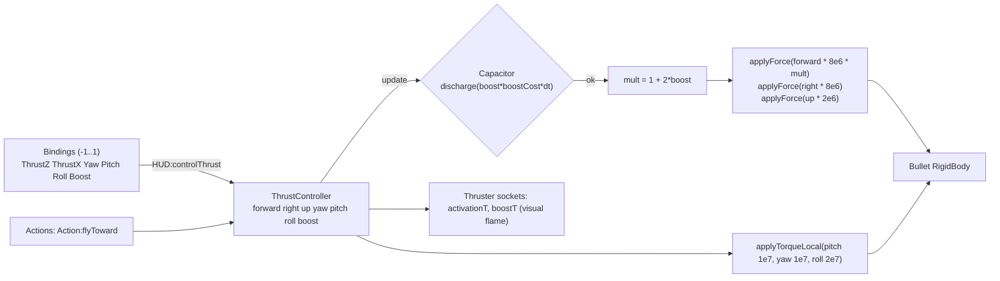
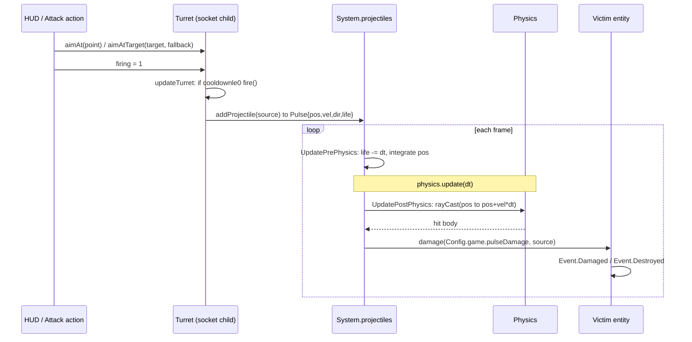
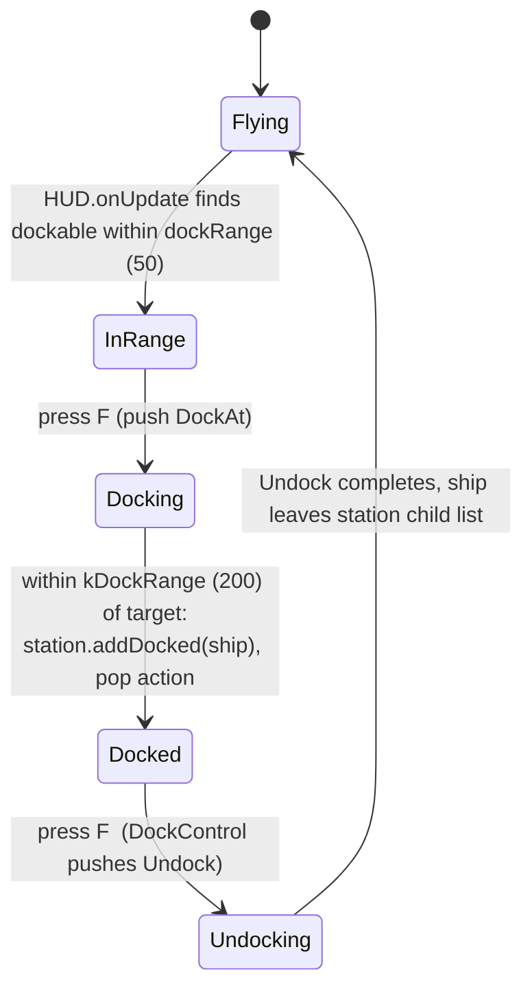
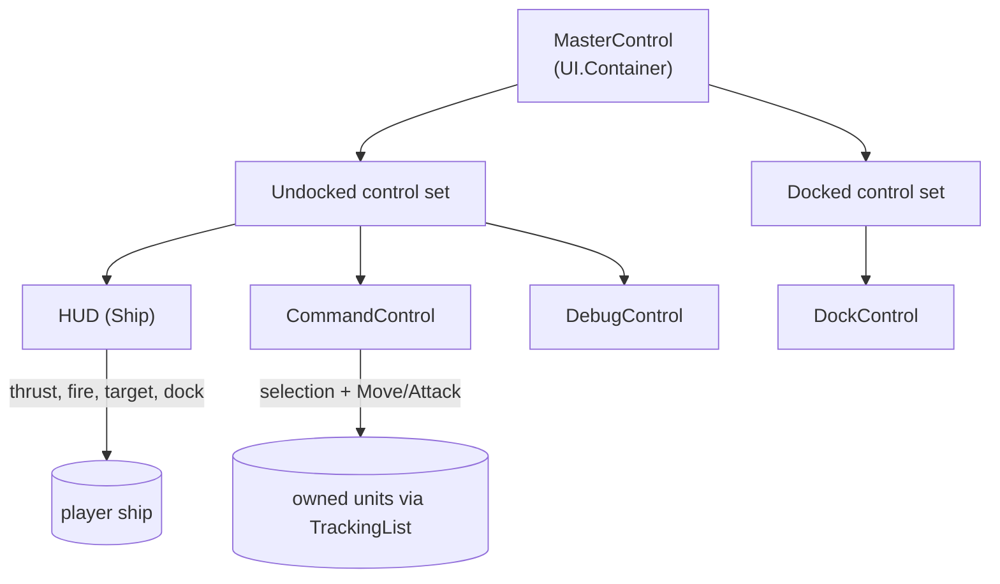
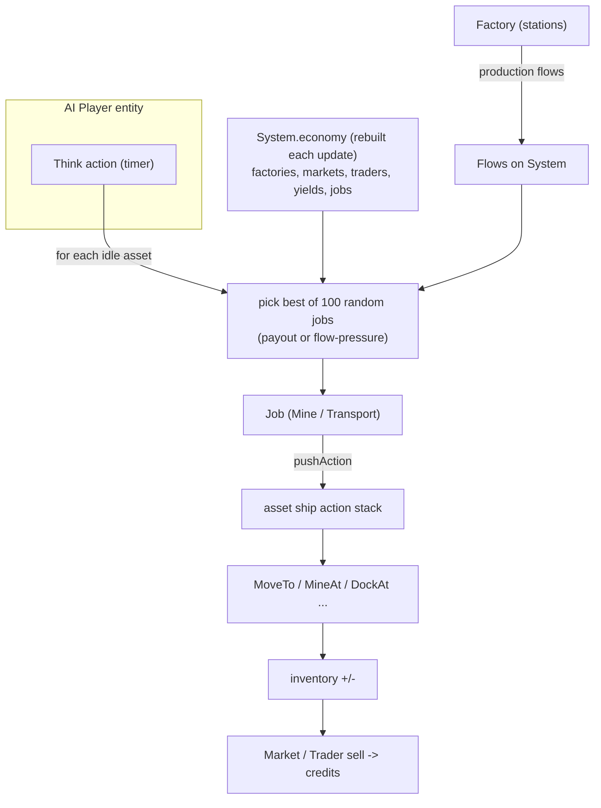
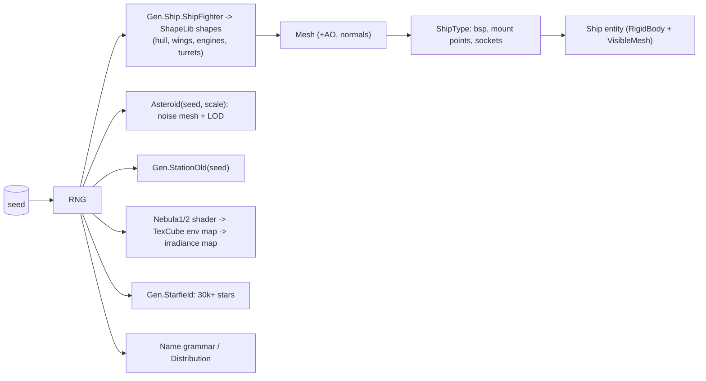
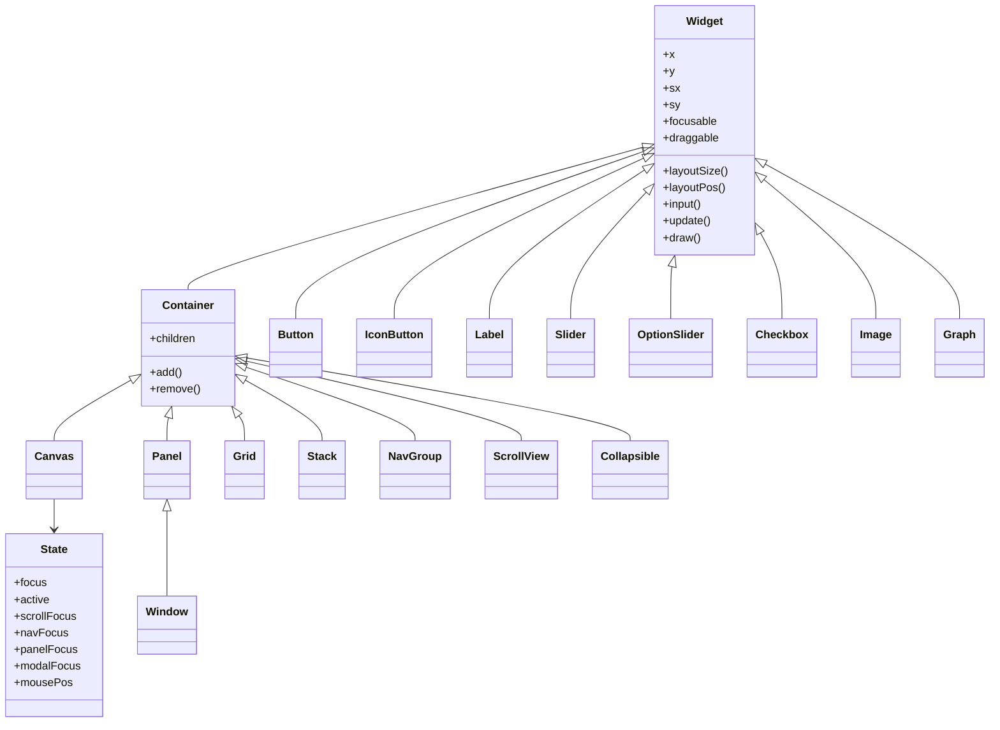

<!-- LimitTheory -->

# Gameplay and technical systems

Deep dives into each subsystem of the game layer. All paths are relative to `script/`.

Contents: [1 Flight](#1-flight-model) · [2 Cameras](#2-cameras) · [3 Combat](#3-combat) · [4 Docking](#4-docking) · [5 Command & control](#5-command--control) · [6 AI & economy](#6-ai-and-economy) · [7 Procedural generation](#7-procedural-generation) · [8 World](#8-world-and-environment) · [9 Rendering](#9-rendering-and-materials) · [10 UI toolkit](#10-ui-toolkit) · [11 Debug](#11-debug-and-profiling-tools) · [12 Settings](#12-settings-and-persistence)

---

## 1. Flight model

Source: `Game/Components/ThrustController.lua`, `RigidBody.lua`, `Game/Controls/HUD.lua`, `Game/Entities/Ship.lua`.

The ship is a Bullet rigid body. Controls never move it directly; they write **normalised thrust demands** into its `ThrustController`, which converts them into forces and torques each frame.

| Parameter | Value | Source |
|---|---|---|
| Max forward / backward force | 8·10⁶ / 2·10⁶ | `thrustForwardMax/BackwardMax` (backward cap is not applied — known bug) |
| Max strafe right / up | 8·10⁶ / 2·10⁶ | |
| Max pitch / yaw / roll torque | 10⁷ / 10⁷ / 2·10⁷ | |
| Boost | thrust ×(1 + 2·boost); costs `Config.game.boostCost` (10) energy/s; ignored if the capacitor can't pay | |
| Ship mass | `50 · radius³` | `Ship.lua` |
| Drag | linear 0.75, angular 4.0 | `setDrag(0.75, 4.0)` |
| Player ship | friction 0, sleep threshold 0 | `LTheory:generate` |
| `getTopSpeed()` | constant 100 (used by AI travel estimates) | |

The `Pitch` and `Yaw` demands come from mouse position offsets (hold **Space**) or the right stick; see [`../CONTROLS.md`](../CONTROLS.md).

## 2. Cameras

`Util/Camera.lua` is the base (view/projection matrices, NDC/screen/window conversions, `mouseToRay`, `entityToScreenRect`). Two subclasses, selected by `GameView:setOrbit(bool)`:

| Camera | Used by | Behaviour |
|---|---|---|
| `CameraChase` | Ship/HUD panel | Third person behind the target at `posRel = (0,4,-10)` scaled by ship radius and zoom; looks along `lookAtRel`; leans with angular velocity; exponential radius smoothing |
| `CameraOrbit` | Command, Debug, Dock panels | Orbits a centre point (`target` entity or free `center`) with yaw/pitch/radius; `modCenter`, `setRelative`, `lerpFrom(pos, rot)` for smooth transitions |

Panels call `camera:push()` / `pop()` around input so `Control.MouseX()` etc. use the right viewport.

## 3. Combat

Source: `Entities/Turret.lua`, `Entities/Pulse.lua`, `Components/Projectiles.lua`, `Components/Health.lua`, `Components/Explodable.lua`, `Actions/Attack.lua`.

* **Fire rate**: `cooldown` is set to 1.0 on fire and drained by `dt · Config.game.rateOfFire` (10) per second.
* **Projectile**: velocity = `dir · pulseSpeed (600)` + shooter velocity; lifetime = `pulseRange / pulseSpeed`; spread = `pulseSpread` × exponential noise.
* **Lead targeting**: `Turret:aimAtTarget` solves an intercept with `Math.Impact(...)` and aims there only if the impact time is within the projectile's life; otherwise aims at a fallback point.
* **Hit detection**: a swept ray per pulse per frame; the hit body's top-level parent is resolved to an entity via `Entity.fromRigidBody`; a pulse never hits the entity that fired it.
* **Pooling**: pulses are `CType.Struct` records in an array, swap-removed on expiry; `Ref` ids keep the source entity alive for the pulse's lifetime.
* **Health**: `Entity:damage(amount, source)`; at 0, `Event.Destroyed` triggers `Explodable` (8 explosions, owner asset removal, action stack cleared) and thruster shutdown.
* **Rendering**: pulses draw additively as camera-facing billboards (head quad + axis-aligned tail) using shader `effect/pulsehead|pulsetail`.

AI combat: the `Attack` action closes to between `radiusMin` (2 × target radius + own radius) and `radiusMax` (shortest turret range), sets the entity's target and fires based on `Config.game.aiFire(dt, rng)`.

## 4. Docking

* `Dockable` makes an entity a container: `addDocked(e)` simply **reparents** the ship under the station (`addChild`), so while docked the player's root is the station and `MasterControl` switches to the *Docked* control set.
* `DockAt` flies to `station.pos − up·(1.25·stationRadius + shipRadius)`; with `Config.debug.instantJobs` it teleports toward the point at `Config.debug.jobSpeed`.
* A destroyed station damages and ejects its occupants.

## 5. Command & control

Source: `Game/Controls/*`. See [`../CONTROLS.md`](../CONTROLS.md) for keys.

* **Control sets** are tables `{ predicate, container, controls[] }` in `MasterControl.lua`. Each frame the **last set whose predicate is true** wins (`not currentAction` → undocked; `parent:hasDockable()` → docked). Switching fades panels via `UI.Panel:enable/disable`.
* A **control panel** is a `UI.Panel` subclass with `Create(gameView, player)`, `onEnable/onDisable` (camera setup), `onInput`, `onUpdate`, `onDraw`, and an `icon` drawn in the control-selector bar.
* **CommandControl** keeps `units = TrackingList(player, Entity.isAlive)`, projects every unit to a screen rect each frame (`camera:entityToScreenRect`), supports drag-box selection with Replace/Toggle/Add/Remove modes, groups (4 slots incl. *Friendlies*), a context menu (`ContextEntries`: Move To with range slider, Attack), a details window, and focus/lock-focus camera.
* **Bindings** are declared with `WIP/Control.lua` combinators (`Key`, `Pair`, `Or`, `And`, `MouseButton`, `GamepadAxis`, `:delta()`, `:invert()`, `:setMult()`, `:setExponent()`, `:setDeadzone()`), keeping device mapping separate from intent.

## 6. AI and economy

1. `System:spawnAI(n)` creates a `Player`, gives it `n` ships, credits and a `Think` action.
2. `Think:manageAsset(asset)` evaluates up to 100 random jobs from `root:getEconomy().jobs` (`Config`-independent constant `kJobIterations`), choosing the one with best **payout** (current mode) or lowest **pressure** (alternative implementation present in the file), then pushes it.
3. `Mine(src, dst)` computes flows (`floor(capacity / itemMass) / travelTime`) and payout from the destination trader's sell price; it flies to the asteroid, mines (`MineAt`), returns and sells.
4. `Factory` converts inputs to outputs over each `Production.duration`, stalling when blocked; `Flows` aggregate net item rates per location so jobs can target scarcity.
5. `Market`/`Trader` match buy and sell orders by price.

Status: the economic loop exists end-to-end and is exercised by `TestEcon`; in `LTheory` AI spawns (`spawnAI`) are disabled in `generate()`, so the live game only contains the player's escorts and static stations. Trade-job generation in `Economy:update` is also behind `if false`.

## 7. Procedural generation

Source: `Gen/*`, `Game/ShipType.lua`, `Game/Entities/*`.

* **Shape library** (`Gen/ShapeLib`): `Shape` = vertex list + variable-size polygons with operations (add, transform, extrude, joint-based assembly via `Joint`/`JointField`, `Cluster`, `Parametric`, `Warp`, `Style`, `Scaffolding`). `Shape:finalize()` yields an engine `Mesh`.
* **Ships** (`Gen/ShipFighter.lua`, `ShipCapital.lua`, `ShipLib/*`): hull (`HullStandard/HullSurreal`), wings (`WingsStandard/Surreal/Tie`), `EngineSingle`, `TurretSingle`, surface detail; `Gen.Ship.ShipFighter(seed, res)` picks a variant with the RNG.
* **Mount points**: `Gen.GenUtil.FindMountPoint(mesh, bsp, rng, normal, facing, tries)` ray-casts the BSP to find surface points for turrets (`up` facing) and thrusters (`back` facing), mirrored in X.
* **Generator registry**: `Gen.Generator.Add(type, weight, fn)` / `Get(type, rng)` — used for nebula types (`Nebula1`, `Nebula2` register themselves).
* **Textures/GPU generation**: `GenUtil.ShaderToTex3D / ShaderToTexCube`, `res/shader/fragment/gen|uvbake|sdf`.
* **System generation**: `Entities/System.lua` has `spawnShip/spawnStation/spawnAsteroidField/spawnPlanet/spawnAI` helpers; `Gen/SystemGenerator.lua` + `Gen/System/SystemBasic.lua` provide an alternative config-driven builder.
* **Determinism**: all content derives from a 64-bit seed; set `Config.gen.seedGlobal/seedSystem` or hardcode `self.seed` for reproducible worlds.

## 8. World and environment

| Element | Implementation |
|---|---|
| Star / lighting | `starDir` (random direction) pushed as shader var; lights from entities with `Light` component rendered as point lights |
| Background | `Nebula`: cube env map + irradiance map, drawn on the far plane (`farplane`/`skybox`), plus additive starfield (`starbg`) |
| Dust | `Entities/Dust`: flecks and clouds near the camera give a sense of speed |
| Zones | `Zone` groups an asteroid field; `System:getZones()` |
| Asteroids | `Asteroid(seed, scale)`; ore asteroids get `addYield(item, rate)` |
| Scale | `kSystemScale` 10⁴ units for random placement; `Config.gen.scalePlanet`; `Config.gen.origin` can be set far from 0 to test float precision |

## 9. Rendering and materials

* **Entities render themselves** by registering `Event.Render` handlers (`renderVisibleMesh`, `Turret:render`, `Pulse.Render`, thrusters, explosions, nebula).
* **Material** (`Game/Material.lua`): `Material.Create(name, diffuse, normal, spec)` builds a `ShaderState` from `Cache.Shader('wvp', name)` (i.e. `vertex/wvp` + `fragment/<name>`, e.g. `material/metal`), mips/filters/anisotropy-16-configures the textures and binds `texDiffuse/texNormal/texSpec` when the shader declares them; `setState(entity)` writes `mWorld`, `mWorldIT`, `scale` by cached uniform index. Presets: `Material.Metal()`, `Debug()`, `DebugColor()`, `DebugColorA()`; `reload()` rebuilds on F5.
* **VisibleLodMesh** chooses between meshes by distance (asteroids).
* **GameView** composes the passes ([ARCHITECTURE.md §3](ARCHITECTURE.md#3-the-frame)); post effects are toggled from `Settings` (`postfx.*`).
* **Shader variable cache** (`phx/util/ShaderVarCache.lua`) pre-resolves uniform indices for hot loops (Pulse, Turret).

## 10. UI toolkit

A retained-mode widget system implemented in Lua (`UI/`), separate from the engine's immediate-mode `HmGui`.

* **Canvas** is the root: each frame it computes mouse focus (`findMouseFocus`), manages click/drag/activation using `UI/Bindings.lua`, handles modal focus, and drives `layoutSize` → `layoutPos` → `draw`.
* **Layout**: widgets have desired/min/max/fixed sizes, padding, `align` and `stretch` factors; `Grid` places children in rows/columns; `Stack` overlays; `NavGroup` defines keyboard/gamepad navigation clusters (Q/E to jump between groups).
* **Panels/Windows** fade in/out (`enabledT`) and may be modal; `Window` is draggable with a title.
* **DrawEx** provides themed primitives (outline rect, ring, cross, wedge, additive text) using `Config.ui.color`.
* The same visual language is used by control icons in the Control Selector.

## 11. Debug and profiling tools

| Tool | How |
|---|---|
| Debug window | `GUI/DebugWindow.lua`: profiling text/graphs, audio stats, UI focus info, auto-generated settings sections |
| Widget inspector | **F1** on a focused widget (Debug panel) |
| Entity debug dump | `Event.Debug` with a `DebugContext` (`Game/DebugContext.lua`) — components implement `debugX` |
| Profiler | F10; `Profiler.Begin/End` around every update/render phase (`Frame`, `App.onUpdate`, `Physics Update`, `Pulse.*`, `Economy.Update`, `Canvas.*`) |
| Metrics bar | `Config.debug.metrics` — ms, fps, GC MB, K tris, draws, imms, FBO swaps |
| Physics overlay | `Config.debug.physics.draw*` (bounding boxes, triggers, wireframes) |
| Instant jobs | `Config.debug.instantJobs`/`jobSpeed` teleports AI ships along job paths |
| Time acceleration | hold **H** |

## 12. Settings and persistence

* **Settings** (`env/util/Settings.lua`): typed entries (`addBool/addFloat/addEnum`) with key, label, default, min/max; `Settings.get/set/getter/getAll`. The debug window iterates `Settings.getAll()` to build UI.
* **Config**: static Lua tables (§7 of [DATA_STRUCTURES.md](DATA_STRUCTURES.md)).
* **Persistence**: *none*. There is no save/load; worlds are regenerated from a seed each launch and settings reset to defaults.
