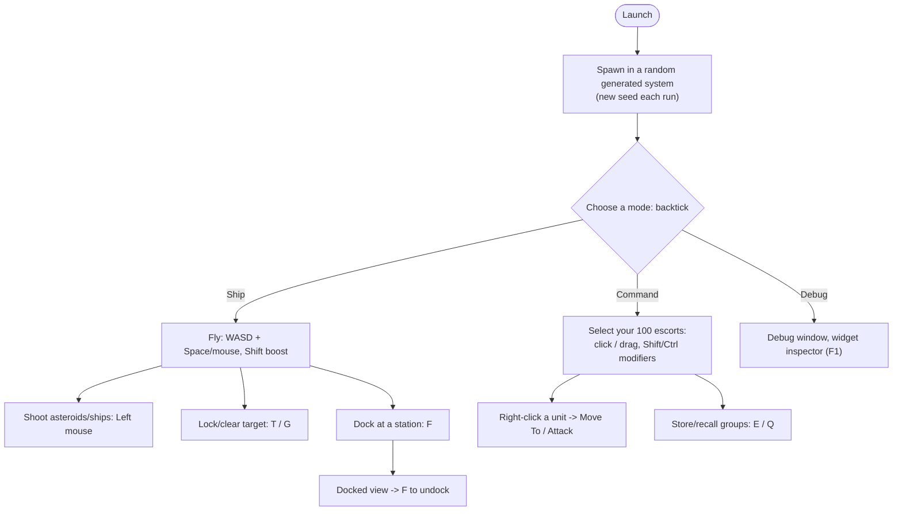

<!-- LimitTheory -->

# Using Limit Theory

How to build, launch, play, configure and troubleshoot the game. This page is a map; details live in the linked documents.

## 1. Quick start

| Step | Command / document |
|---|---|
| 1. Get the code (with LFS assets) | `git clone https://github.com/DieSlower/LimitTheory.git` (needs Git LFS) — [`../BUILDING.md`](../BUILDING.md) |
| 2. Build | `cmake -S . -B build -G "Visual Studio 17 2022" -A x64 -DCMAKE_POLICY_VERSION_MINIMUM=3.5` then `cmake --build build --config RelWithDebInfo` |
| 3. Run | `.\bin\lt64.exe` from the repo root — [`../RUNNING.md`](../RUNNING.md) |
| 4. Play | Controls in [`../CONTROLS.md`](../CONTROLS.md) |

System requirements: Windows 10/11 x64, a GPU/driver supporting OpenGL 3.0+, ~500 MB disk for assets, an audio output device (FMOD).

## 2. What you can do in the game

There are **no missions, win/lose conditions or progression**: it is a sandbox demonstrating flight, combat, command and procedural generation.

## 3. The screen

| Region | Meaning |
|---|---|
| Centre | Blue reticle |
| Overlays | Target brackets (off by default in `Config.Local.lua`), lock indicator |
| Top centre | Control Selector bar (toggle with `` ` ``) with Ship / Command / Debug icons |
| Debug window | Profiling, audio, UI info and settings sliders (shown by default; toggled with `` ` `` in the Debug panel) |
| Bottom bar | `ms / fps / MB / K tris / draws / imms / swaps` |
| Command view | Unit markers (corner brackets), selection box, context menu |

## 4. Configuration

| Want to… | Do this |
|---|---|
| Hide the debug window | `Config.debug.window = false` in `script/Config.Local.lua` |
| Hide the metrics bar | `Config.debug.metrics = false` |
| Show target trackers | `Config.ui.showTrackers = true` |
| Change visuals | Debug window → *postfx* / *render* sections (bloom, tonemap, supersample, FOV, wireframe) |
| Turn off vsync | `Config.render.vsync = false` (set by default in `Config.Local.lua`) |
| Start in a different mode | `Config.ui.defaultControl = 'Command'` |
| More / fewer things | `Config.gen.nFields`, `nStations`, `nPlanets`, `nTurrets`, `nThrusters` |
| Repeatable world | set `self.seed = <number>ULL` in `App/LTheory.lua` or `Config.gen.seedGlobal` |
| Faster time | hold **H** (`Config.debug.timeAccelFactor`) |
| Invert pitch | `Config.game.invertPitch = true` |
| Aim assist | `Config.game.autoTarget = true` |
| Fullscreen | **F11** |

Edit `Config.Local.lua`, not `Config.App.lua` (the latter holds upstream defaults). Press **F5** in-game to reload scripts/assets.

## 5. Other programs in this repo

| Command | What |
|---|---|
| `bin\lt64.exe TestEcon` | Economy simulation viewer |
| `bin\lt64.exe PhysicsTest` | Physics sandbox |
| `bin\lt64.exe BSPTest` | Mesh/BSP viewer |
| `bin\lt64.exe InputTest` | Input monitor |
| `bin\lt64.exe TestHmGui` | GUI demo |

Full table with working/failing status: [`../RUNNING.md`](../RUNNING.md#3-other-runnable-apps).

## 6. Performance tips

* The world has 100 escort ships: lower escort counts in `App/LTheory.lua` (`for i = 1, 100`) for slower machines.
* Lower `render.superSample` to 1× in the debug window.
* Disable *Bloom* and *Sharpen* post effects.
* Close the debug window (**`** in Debug panel) and set `Config.debug.metrics = false`.
* Use the profiler (**F10**) and the Profiling section of the debug window to see where frame time goes.

## 7. Troubleshooting

See the tables in [`../BUILDING.md`](../BUILDING.md#6-troubleshooting), [`../RUNNING.md`](../RUNNING.md#5-troubleshooting) and [`../Engine/FAQ_LIMITATIONS.md`](../Engine/FAQ_LIMITATIONS.md#troubleshooting-matrix).

Common console messages that are **not** errors:

| Message | Meaning |
|---|---|
| `Warning: Game.Socket is shadowing PHX.FFI.Socket in _G` | Two globals share a name; harmless |
| `Bad normal at poly: …` | The procedural mesh validator found degenerate faces; the mesh is still used |
| `BSP Incoming Mesh Error: ERROR: Vertex Position …` | Same, from BSP creation |
| `Shader_BindVariables: Automatic shader variable <x> does not exist in shader <…>` | A shader doesn't use a shared variable (`envMap`, `mView`, …); harmless |
