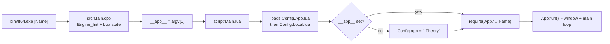

<!-- LimitTheory -->

# Running Limit Theory (the game, its apps and mods)

How to launch the main game and every other runnable script in this repository, based on the repo `README.md`, `configure.py`, `src/Main.cpp`, `script/Main.lua` and a smoke test of each script on this machine. Build steps are in `CLAUDE.md`; controls are in [`CONTROLS.md`](CONTROLS.md).

## 1. How launching works



- `lt64.exe` is only a tiny host: it initialises the engine (`libphx64.dll`), creates a LuaJIT state and runs `./script/Main.lua`.
- The **first command-line argument** is the app name (file `script/App/<Name>.lua`, without extension). With no argument the app named in `Config.app` runs: **`LTheory`**, the game.
- The **working directory must be the repo root**. If `./script/Main.lua` is not found the exe tries `..\` once, then fails with "can't find script entrypoint". Asset paths (`res/...`) are resolved relative to the working directory too.
- All game rules, UI and content are Lua scripts; the engine DLL provides rendering, physics (Bullet), audio (FMOD), input, windowing.

## 2. The main game

There is exactly one game: **`LTheory`** (`script/App/LTheory.lua`). Limit Theory is a cancelled project, so this is a technical prototype, not a finished game: you fly one ship, with 100 escorts, around a procedurally generated system (seeded randomly each launch, printed as `Seed: …` in the console) containing a station and an asteroid field.

```powershell
cd D:\Development\LimitTheory
.\bin\lt64.exe              # same as: .\bin\lt64.exe LTheory
# or via the helper (needs Python):
python configure.py run
python configure.py run LTheory
```

What you will see: a 1600×900 resizable window titled *Phoenix Engine Application*, a debug window on the left (it is on by default), and a metrics bar at the bottom. Press `` ` `` for the control panels. See [`CONTROLS.md`](CONTROLS.md).

### Fixing a seed / changing generation

`LTheory:generate()` uses `RNG.FromTime()`. To replay a world, edit `script/App/LTheory.lua` and set `self.seed = <number>ULL` (several seeds are present as commented examples), then press **F5** (hot reload) or relaunch.

Generation and tuning are read from config tables in `script/Config.App.lua` and overridden by `script/Config.Local.lua`:

| Setting | Default (App → Local override) | Effect |
|---|---|---|
| `Config.gen.nFields` | → `1` | Asteroid fields |
| `Config.gen.nPlanets` | → `0` | Planets |
| `Config.gen.nStations` | → `2` | Stations |
| `Config.gen.nTurrets` / `nThrusters` | → `1` / `2` | Ship turrets / thrusters |
| `Config.game.autoTarget` | `false` | Turrets aim at the locked target |
| `Config.game.invertPitch` | `false` | Invert pitch |
| `Config.ui.showTrackers` | `true` → `false` | HUD target brackets |
| `Config.ui.defaultControl` | `'Ship'` | Panel active at launch (`Ship`, `Command`, `Debug`) |
| `Config.debug.window` / `metrics` | `true` | Debug window / bottom metrics bar |
| `Config.debug.timeAccelFactor` | `10` | Speed-up while holding **H** |
| `Config.render.vsync` | → `false` | Vertical sync |

Edit `Config.Local.lua` rather than `Config.App.lua`: it is the file intended for per-machine changes and is loaded last.

## 3. Other runnable apps

Run any of them with `.\bin\lt64.exe <Name>`. Results of launching each one for ~8 s on this machine (Windows 11, RelWithDebInfo build):

| Name | Purpose | Result |
|---|---|---|
| `LTheory` | **The game** | Runs |
| `TestEcon` | Economy simulation (stations, producers, traders); window title *Economy Simulation* | Runs (prints a `BSP Incoming Mesh Error` warning) |
| `PhysicsTest` | Collision / trigger / bounding-box sandbox with a controllable ship and two asteroids | Runs |
| `BSPTest` | BSP mesh-building viewer and benchmarks | Runs |
| `InputTest` | Prints keyboard/mouse/gamepad button events | Runs |
| `TestHmGui` | Immediate-mode GUI (HmGui) widget demo | Runs |
| `TestStrMap` | String-map unit test | Runs / no window content |
| `CoordTest` | Coordinate/quaternion tests and viewer | Prints `test_quat_identity Passed` lines, then exits |
| `TestImGui` | Dear-ImGui style GUI demo | **Fails**: needs `./screenshot/wp2.png`, which is not in the repo |
| `Todo` | Project to-do checklist UI | **Fails**: same missing `./screenshot/wp2.png` |
| `TestIcon` | Icon test | **Fails**: `undefined global variable 'Icon'` |
| `FMODTest` | Audio test | **Fails**: `undefined global variable 'Key'` |
| `GenTex2D` | Texture generation | **Crashes** (memory access violation in `Create`) |

To make `TestImGui` / `Todo` run, create `screenshot\wp2.png` (any image) in the repo root.

## 3a. Launcher scripts (`Launch\*.bat`)

Double-click launchers for every app; each one changes to the repo root, checks that `bin\lt64.exe` exists and starts the app.

| Launcher | Runs | Status |
|---|---|---|
| `Game.bat` | `LTheory` - the main game | Runs |
| `Economy-Simulation.bat` | `TestEcon` | Runs |
| `Physics-Sandbox.bat` | `PhysicsTest` | Runs |
| `BSP-Mesh-Viewer.bat` | `BSPTest` | Runs |
| `Coordinate-Test.bat` | `CoordTest` | Prints results, exits |
| `Input-Test.bat` | `InputTest` | Runs |
| `GUI-Demo-HmGui.bat` | `TestHmGui` | Runs |
| `StrMap-Test.bat` | `TestStrMap` | Runs |
| `GUI-Demo-ImGui.bat` | `TestImGui` | Needs `screenshot\wp2.png` |
| `Todo-Checklist.bat` | `Todo` | Needs `screenshot\wp2.png` |
| `Icon-Test.bat` | `TestIcon` | Known broken |
| `Audio-Test-FMOD.bat` | `FMODTest` | Known broken |
| `Texture-Generator.bat` | `GenTex2D` | Known broken (crash) |
| `Launcher-Menu.bat` | Numbered menu of all of the above, plus Build / Clean | - |
| `Build.bat` | Configure (first time) and build `RelWithDebInfo` | - |
| `Clean.bat` | Delete `build\` and `bin\` (asks first) | - |

## 3b. Is there a tech-tree / research screen, or a ship-generator viewer?

* **Research / tech tree GUI: no.** The only traces are a *"Research"* checkbox in the `Todo` checklist app (`script/App/Todo.lua`) and a mention of a planned `ResearchControl` in the header comment of `script/Game/Controls/MasterControl.lua`. There is no technology data, no research logic and no UI. A new control panel would be the place to build it (recipe in [`Game/EXTENDING.md`](Game/EXTENDING.md) section 7).
* **Procedural ship generation: no dedicated viewer.** The generators live in `script/Gen/` (`Ship.lua`, `ShipFighter.lua`, `ShipCapital.lua`, `ShapeLib/*`, `ShipLib/*`) and are used through `ShipType` when `System:spawnShip()` runs. You can *see* generated ships in `Game.bat` (the player ship and 100 escorts share one `ShipType`; a new seed per launch gives a new hull), `Physics-Sandbox.bat` and `Economy-Simulation.bat`. Mesh quality tools exist in `BSPTest`.

## 4. Mods

**There is no mod system in this build.** Evidence from the repository:

- The README says only that *"the intention was for Limit Theory (and all mods) to be broken into many Lua scripts"* — mods were planned, not implemented. There is no mod loader, manifest, workshop or plugin directory.
- `script/Game/Content.lua` is explicitly a *"placeholder file for directly adding game content that would typically be added in mod format"* (items such as Energy Cell, Silver; production recipes such as Solar Energy Array, Nuclear Reactor).
- The older C++/LTSL game lives in a separate repository, [`ltheory-old`](https://github.com/JoshParnell/ltheory-old), and is not covered here.

### What "modding" means in practice

Because everything is a script, you extend the game by editing or adding Lua files; nothing needs recompiling (only the `.dll`/`.exe` need a build if you touch C++ in `libphx`):

| I want to… | Where | Notes |
|---|---|---|
| Add items / production recipes | `script/Game/Content.lua` | Uses `Item(...)` and `Production(...)` builders |
| Add or change entities, ships, stations | `script/Game/Entities/`, `script/Gen/Ship*.lua`, `script/Gen/Station.lua` | Spawned by `System:spawnShip()` etc. in `LTheory.lua` |
| Add AI actions / orders | `script/Game/Actions/` | Add to the Command menu table in `script/Game/Controls/CommandControl.lua` (`ContextEntries`) |
| Change keys | `script/Game/Controls/*Bindings.lua`, `script/UI/Bindings.lua` | See [`CONTROLS.md`](CONTROLS.md) |
| Change tunables | `script/Config.Local.lua` | Loaded after `Config.App.lua` |
| Create a new standalone app/scene | new `script/App/MyApp.lua` | Must return an `Application()` subclass; run with `lt64.exe MyApp` |
| Change meshes, textures, shaders, sounds | `res/` (`mesh`, `tex2d`, `shader`, `sound`, `font`) | LFS-tracked binaries; shaders are GLSL in `res/shader` |

Minimal new app (`script/App/Hello.lua`):

```lua
local Hello = Application()

function Hello:onInit   ()   end
function Hello:onUpdate (dt) end
function Hello:onDraw   ()
  Draw.Clear(0.1, 0.1, 0.15, 1)
end

return Hello
```

Run it with `.\bin\lt64.exe Hello`. **F5** reloads scripts in a running session, so most Lua edits do not need a restart.

## 5. Troubleshooting

| Symptom | Cause / fix |
|---|---|
| `cannot load module 'libphx64'` | The DLL name must match the build type; build `RelWithDebInfo` (see `CLAUDE.md`). Do not copy `libphx64r.dll` to `libphx64.dll` — two copies of the engine get loaded. |
| `Resource_Resolve: Failed to find Font <Share>` (or any resource) | Working directory is not the repo root, or LFS assets weren't pulled (`git lfs pull`). Two engine copies loaded (see above) also produce this. |
| Popup *PHX Engine: Fatal Error* | The message names the missing resource or failing call; check the console output. |
| `can't find script entrypoint <./script/Main.lua>` | Run from the repo root. |
| Window appears but game is empty/black | Wait for generation (a few seconds); check `Config.Local.lua`. |
| Mesh/texture files are tiny text files | Git LFS pointers; run `git lfs pull`. |
